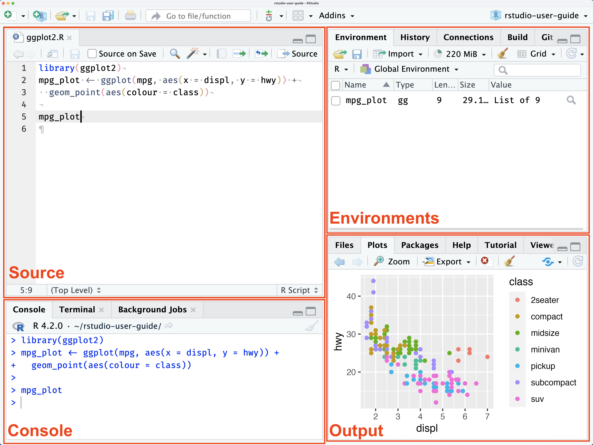

<!-- ENSURE THAT THIS DOCUMENT FOLLOWS THE MODULE STRUCTURE DESCRIBED IN THE GUIDELINES -->
<!-- https://docs.google.com/document/d/16cxSA2bA1MnrnpzmN2yzJNCwJVO7Hm5ceyz10sCmnzY/edit?tab=t.0 -->

## Let's get started

The first part of this module will introduce you to RStudio. We'll start from the very beginning. By the end of this tutorial, you should be able to:

- Explain what each panel does within the RStudio interface
- Navigate and open files, view objects, and access help
- Distinguish between the console and a script

You'll then be ready to launch a project and start coding in R.

*Duration: 10-15 minutes*

## Why use RStudio?

[RStudio](https://posit.co/products/open-source/rstudio){target="_blank"} is a free, open-source integrated development environment (IDE) that supports coding in R among other languages (e.g., Python). As mentioned previously, it's like the dashboard of a car. RStudio contains a variety of features presented in an accessible graphical interface that allows you to write and save code, with R running under the hood.

With RStudio, you can:

- Write code within scripts that can be formatted, saved, edited, and reused
- Manage working directories using Projects (we'll get to this in a bit!)
- Publish and share slides, reports, and apps
- Easily access data and objects
- Preview plots and data in real time
- Receive automated coding and debugging help (e.g., code completion and syntax highlighting)
- Access documentation for packages and functions

## Navigating the RStudio IDE

The RStudio interface has four main panes:

1) **Source**: where you open, edit, and save scripts or other documents (e.g., Quarto or Markdown)
2) **Console**: where the code runs
3) **Environment**: shows objects created during the session
4) **Output**: displays plots, tables, and other outputs generated from the code, in addition to files, packages, and help



Additionally, there are a variety of features available in the top toolbar. One in particular to explore is "Global Options" (**Tools** > **Global Options**). There, you can customize your RStudio interface and adjust other settings.

::: {.callout-tip}
## A reproducibility tip

It's best to clear R's memory after each session so you start from a blank slate. This ensures that the scripts are self-contained and prevents old objects from being carried over into a new session, where they may silently (or sometimes not so silently) wreak havoc. You can turn this feature off in **Tools** > **Global Options** by unclicking "Restore .RData into Workspace at Startup" and choosing Never on the "Save workspace to .RData on exit".
:::

To continue getting oriented with RStudio and its functionality, watch this video (~6 min):



## Where to find help

You can find additional resources in the toolbar under "Help". For example, click **Help** > **Cheat Sheets** to download a one-page overview of the RStudio IDE.

To access the documentation for a particular package or function directly within RStudio, go to the "Help" tab in the Output panel.

A final way to get help is to use `?` or `help()`:

```{r}

#documentation for a function
?mean
help(mean)

#documentation for a package
help(package = "palaeoverse")

```

## Working with scripts and files

Now that you've become acquainted with the RStudio workspace, we're now ready to start cooking. A good place to start is the recipe---you need to tell R which objects (ingredients) to use and what to do with them in an ordered way (steps) to produce your analysis or plot (the cake in this metaphor). You'll want to develop this code in a script or as a Quarto or R Markdown document so you can save, edit, and share it with others. If you were to otherwise type directly into the console and then close R, you'd lose that code, which would be both sad and not reproducible!

To create a new script, click **File** > **New File** > **R Script** (or click on the icon below **File** showing a white square with a green plus sign). This will open a blank editable file within the Source panel. You'll notice there are a variety of document types to choose from under **New File**, including a Quarto Document (what this page is) and R Markdown document (precursor to Quarto). These two file types support Markdown syntax and allow you to interweave plain text with code chunks. They're helpful for creating nice-looking reports, presentations, or tutorials that can be rendered into HTML or PDF formats for easy sharing, or just as a way to record notes and keep your workflow organized.

## Continuing your journey

Now that you can work with files in RStudio, you'll want to keep them organized. Like any file, it's important to think about where you store your scripts and other outputs in relation to other files---particularly any datasets you plan to use in your workflow. The Project Management section of the module will cover this topic in more detail. For now, the most important concept to understand is the working directory. This is where RStudio looks for files. For instance, if 'super_cool_data.csv' is saved on your computer but is not found within the working directory file path, R will not be able to locate it. The easiest way to keep your relevant files together and findable by R is to create a Project. Turn to the next page to learn more.

## Resources

To learn more about RStudio's features, check out the [User Guide by Posit](https://docs.posit.co/ide/user/){target="_blank"} and [datacamp tutorial](https://www.datacamp.com/tutorial/r-studio-tutorial){target="_blank"}.
