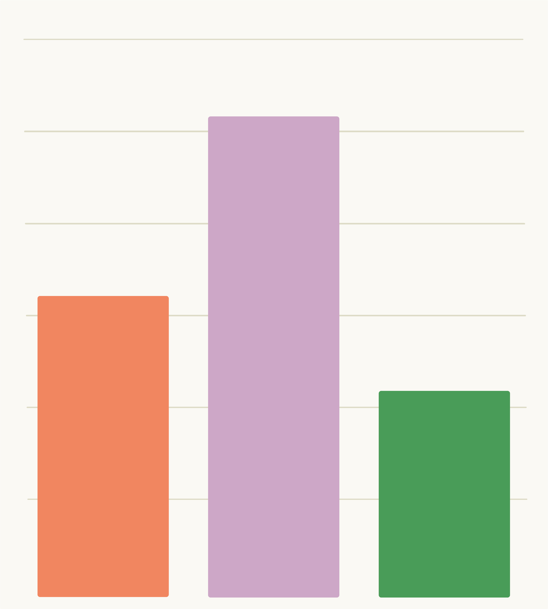

<!-- ENSURE THAT THIS DOCUMENT FOLLOWS THE MODULE STRUCTURE DESCRIBED IN THE GUIDELINES -->

<!-- https://docs.google.com/document/d/16cxSA2bA1MnrnpzmN2yzJNCwJVO7Hm5ceyz10sCmnzY/edit?tab=t.0 -->

## Learning objectives

::: slides-only
1.  Understand reasons why archiving data is important
2.  Know what should be archived
3.  Know some places data can be archived, and how to choose where to
    archive
:::

::: narration
The learning objectives for this module are to:

1.  Understand the reasons why archiving data is important
2.  Know what should be archived (spoiler: everything possible!)
3.  Know some places data can be archived, and how to choose where to
    archive
:::

## Pre-requisites and related modules

::: slides-only
<!-- UPDATE: titles of modules/numbering -->

No pre-requisites.

Related modules are any that handle data, particularly:

- R project management

- Data acquisition

- Data management

{fig-align="right" width="200" height="250"}
:::

::: narration
<!-- UPDATE: titles of modules/numbering -->

There are no particular pre-requisites for this module, as the things we
will discuss will be accessible to everyone who has ever handled data at
any level of complexity.

Modules related to this one are any in which data is handled,
particularly:

- R project management

- Data acquisition

- Data management
:::

## Plan for the session

::: slides-only
1.  Get thinking; discuss data archiving questions with your neighbours
2.  Come back together to highlight key ideas
3.  Major reasons for archiving data
4.  What should be archived
5.  Where to archive, and trade-offs when choosing where
6.  Open access publishing and licensing
:::

::: narration
The plan for this module is:

1.  First of all to get thinking about data archiving. If this module is
    in-person, you will discuss data archiving questions that I will put
    up in a minute with your neighbours, and report back your ideas.
2.  We'll then come back together to highlight some key ideas for each
    of the questions.
3.  After this, I will run through the major reasons for archiving data,
    in case there is anything we've missed so far.
4.  I will also run through what should be archived: the short answer is
    everything.
5.  I will then give you some options for where to archive data, and
    we'll go through some trade-offs to consider when choosing where.
6.  Finally, I'll give a quick run through of open access publishing and
    licensing for your data.
:::

## Group discussion!

::: narration
First of all, let's get talking about archiving our work. Think about
the following questions and discuss your thoughts with your neighbours.
Then write some answers, and have a look at what your colleagues think
is important in archiving research outputs.

25 minutes, then we’ll come back together to go over the important
points!
:::

::: slides-only
Let's get talking about archiving our work!

**Think** about the following questions...

**Discuss** your thoughts with your neighbours...

**Write** some ideas...

**Post** these and have a look at the other posts

{fig-align="right" width="400" height="300"}
:::

::: callout-note
## Discuss these questions - write your answers on post-its!

1.  *Why* is archiving important?
2.  *What* do you think is important to archive?
3.  *Where* can you archive data?
4.  What are the *major barriers* to archiving?

**25 minutes!**

{fig-align="right" width="230" height="250"}
:::

::: {.callout-caution collapse="true"}
## What do you think?

Let's go through a few of the answers - can I have a volunteer for each
of the four questions to read out just a few of the post-its?

1.  *Why* is archiving important?
2.  *What* do you think is important to archive?
3.  *Where* can you archive data?
4.  What are the *major barriers* to archiving?
:::

## Why archive data?

::: slides-only
- Support open science

- Transparency

- Reinforce good practices

- Reproducibility and replicability

- Reusability for future research

- Future You

- Citeability

- Prevent duplicated efforts
:::

::: narration
There are many reasons why we want to archive our data.
<!--# QUICKLY SKIP OVER THOSE THAT HAVE BEEN COVERED ALREADY IN DISCUSSION ACTIVITY -->

Firstly, archiving our data means it is **accessible to everyone** -
this reinforces the idea that all our scientific outputs should be
freely available to all. This is also important for **transparency**;
everyone can see what data our results and conclusions are based upon,
and everyone can see what decisions we've made regarding obtaining and
cleaning our data. Archiving data can also be used to **reinforce good
practices** in the field; you can demonstrate to colleagues how data
should be properly managed and archived. Only by being the change we
want to see can we inspire others to also properly archive their data.

Importantly, data being archived means we can test whether the results
of a study are **reproducible** and **replicable**. Reproducible means
we can use the archived data and methods to obtain the same results as
the study, providing some verification. Replicable means the methods
used in the study can be used with new data to reach the same
conclusions. Having data archived also means it can be **reused for
future research**, which is important in driving forwards the field. It
might also be of benefit to **Future You**, if you want to continue this
research or you just need to look something up in your data in ten
years!

Archiving data also benefits you in terms of your publication record:
**data can (and should be)** **cited**, which records the value of your
data contributions to the field, not just the final publications you
write. Lastly, archiving data can prevent others **duplicating your
efforts**. Your colleagues might be interested in testing a question
which your archived data can already answer (which should also gain you
a citation!). In the case of negative results, this can be particularly
valuable.
:::

## What should be archived?

::: callout-note
**Everything!**

...that is possible, within reason.
:::

::: slides-only
- Raw **and** processed data

- Code

- Supplementaries

- Workflow

- Thoughts and feelings...

{fig-align="right" width="200" height="200"}
:::

::: narration
The short answer is that **everything possible should be archived**.
Depending on the project, this could include:

- your final datasets, but also the raw data you started with

- any code you have used for analyses

- supplementary data or figures

- the details of your data cleaning and/or analytical workflow

- what you were listening to or the weather...

This last one of course is a bit of a joke, but serves to emphasise that
you should archive anything to do with a project that you think could be
useful to you or a colleague in future. Regarding datasets, it's also
really important that you **archive your raw data**; this is the data
you started with, for example, collected measurements from field
specimens or a download from the PBDB, which you archive *before* doing
any filtering or cleaning. Making these raw data available mean that
your work is fully transparent and reproducible, and allows you to look
back on changes you made in future when you've forgotten.
:::

### How to archive

::: slides-only
1.  In **non-proprietary file formats**
2.  With a **metadata (README)** file
    - What the material is and what it is for

    - Explanation of contents

    - How to collaborate with you
    
{fig-align="right" width="250" height="300"}

:::

::: narration
Ideally, data should be archived in **non-proprietary file formats**,
that is, those that can be opened with open software. For example,
instead of .ai files for figures, you should save these as .svg. Or
instead of using Microsoft file formats (e.g., .doc), using OpenDocument
formats (e.g., .odt).

You should also aim to include a **README file** with your archive. This
is a text document that explains the purpose, workflow and usage of the
archived material; this can be invaluable to colleagues using your data,
but also to you in future. It can also contain instructions for users to
properly cite your work, and for how to collaborate with you.
:::

## Where can we archive?

::: slides-only
Some relevant examples:

- [Zenodo](https://zenodo.org)

- [Dryad](https://datadryad.org)

- [FigShare](https://figshare.com)

- [Pangaea](https://www.pangaea.de)

- Institutional / funding body repositories

- Specialist data: [PBDB](https://paleobiodb.org/#/),
  [Neotoma](https://www.neotomadb.org),
  [MorphoSource](https://www.morphosource.org),
  [MorphoBank](https://www.morphobank.org), ...

- Software: [GitHub](https://github.com)
:::

::: narration
There are lots of potential repositories for archiving, such as large
generalised ones like [Zenodo](https://zenodo.org). Many institutions
and funding bodies also have their own repositories, which they might
even require you to archive with. For particular types of data, there
are also specific repositories, such as the
[PBDB](https://paleobiodb.org/#/) for occurrence data or
[MorphoSource](https://www.morphosource.org) for 3D scan data. As you've
seen, we should also use [GitHub](https://github.com) for code or
software releases.

Unfortunately the landscape here keeps changing; for example, the OSF
used to be a key open-access repository, but has just announced (later
2026) it will no longer support archiving. And not all research
repositories are free to archive data in. This means that there are a
few things you need to consider when deciding on a repository...
:::

::: callout-note
## In what ways can different repositories vary?

Can anyone tell us some of the things we need to consider when we decide
which repository to choose for archiving?

A freebie: **not all repositories are free**.

{fig-align="centre" width="300" height="170"}
:::

## Trade-offs with repositories

::: slides-only
Not all repositories are the same; they can vary in:

- Longevity

- Cost

- Capacity

- Accessibility

- Discoverability

- Citeability

- Version control

- Licensing
:::

::: narration
Not all repositories for archiving your data are the same. They can vary
in:

- Longevity - how long they guarantee hosting and making your data
  available

- Cost - Zenodo, for example, is free, but other repositories cost money
  (e.g., Dryad) or can cost after a certain amount of data

- Capacity - as for cost, some repositories limit the quantity of data
  (total, and/or per file) you can archive

- Accessibility - make sure the repository you choose is freely
  accessible for downloads too, not just uploads; for example,
  institutional repositories might allow you to store data, but might
  not be publically accessible

- Discoverability - if you archive on lesser known repositories, and
  institutional ones, it might be harder for others to find your data;
  make sure you choose one properly indexed (e.g., on Scholar,
  Scopus...)

- Citeability - make sure that the repository gives your archive a DOI
  so that others can cite you directly!

- Version control - some repositories allow for this, and others don't,
  for example on Zenodo you can upload new versions of data and retain
  access to the old versions

- Licensing - repositories provide a range of licensing options (which
  we will briefly cover in a minute); for example, Zenodo defaults to
  CC-BY 4.0, but does provide choices

So which repository is suitable for you is a very specific question. We
frequently use Zenodo, as it ticks all the boxes for discoverability and
accessibility, is free, has DOI-linked version control, and links to
GitHub.
:::

## Licensing

::: slides-only
We must choose an appropriate license when archiving, and there are many
options:

- CC0 (public domain)

- Variety of CC-BY

- Software licenses: MIT, Apache, GNU

- Check your work / grant contract!

- Tools for deciding: <https://choosealicense.com> ,
  <https://creativecommons.org/chooser/>
:::

::: narration
There are many licenses to choose from, and we need to pick one for
anything we archive so that others know how they are able to use our
data. For software there are specific licenses, such as MIT or Apache
for making code fully reusable (only requires credit), or GNU
("copyleft") in which all subsequent versions of the software must have
the same licensing (i.e., continue to be free). For other research, you
can choose between creative commons licenses:

- CC0 is public domain, so anyone can use the work freely

- CC BY licenses in general are frequently used, which allow use,
  adaptation and sharing while requiring author credit

- CC BY-NC means others can use the work for non-commercial purposes

Note that some work contracts (e.g., if you don't work for a university)
and grant funding may require you to use certain licenses, and so this
is something you should look into before deciding on an archive license.

These are some helpful tools to assist you in deciding which license to
apply to your archived materials:

- GitHub's license selection tool (software):
  <https://choosealicense.com>

- Creative Commons license tool (non-software research):
  <https://creativecommons.org/chooser/>
:::

## Open access publishing

::: slides-only
Diamond open access journals (palaeontology-specific):

- [*Open Palaeontology*](https://www.openpalaeo.org)

- [*Lethaia*](https://www.scup.com/journal/let)

- [*Palaeontologia
  Electronica*](https://palaeo-electronica.org/content/)

- [*Sedimentologika*](https://oap.unige.ch/journals/sdk/)

Preprint servers (e.g., [*bioRxiv*](https://www.biorxiv.org)*,
[EarthArXiv](https://eartharxiv.org),
[EvoEcoRxiv](https://ecoevorxiv.org/)*)

[*Peer Community in Paleontology*](https://paleo.peercommunityin.org)
:::

::: narration
Finally, we will quickly expand out from archiving to looking at open
access publishing in general. After we've archived all our data and
other materials in an open-access repository, we should also consider
publishing any resulting articles in an open-access journal. Doing so
brings the same benefits we discussed earlier for archiving, including
increased citeability, transparency of work, and improving reuse in
future studies.

In general, we prefer journals that are **diamond open access** - this
means they are free to publish in (big benefit to you) and free for
everyone to access (big benefit for colleagues and the public). There
are a few of these specific to palaeontological research, and other
general journals, such as:

- [*Open Palaeontology*](https://www.openpalaeo.org)

- [*Lethaia*](https://www.scup.com/journal/let)

- [*Palaeontologia
  Electronica*](https://palaeo-electronica.org/content/)

- [*Sedimentologika*](https://oap.unige.ch/journals/sdk/)

- (Non-palaeontology-specific) [*Royal Society Open
  Science*](https://royalsocietypublishing.org/rsos)

Most journals nowadays also accept **preprints** - these are manuscript
versions published prior to peer-review, usually on a specialised
platform (e.g. [*bioRxiv*](https://www.biorxiv.org)*,
[EarthArXiv](https://eartharxiv.org),
[EvoEcoRxiv](https://ecoevorxiv.org/)*). This allows you to get your
work out there to be read and cited without the (often) long wait for
peer review. Usually, manuscripts are preprinted at or around the same
time as being also submitted to a peer-reviewed journal.

Lastly, other options exist, notably *Peer Community in*, which has a
specialised palaeontology platform ([*PCI
Paleontology*](https://paleo.peercommunityin.org)). This is an
alternative way, outside of traditional publishing models, to have your
manuscript peer reviewed. You can submit a preprint, and *PCI* evaluates
the preprint through peer review, then based on the reviews either
publically recommends (or not) the preprint.
:::

## Resources

See specific slides for more links to open science journals,
repositories, etc.

- Tools for licenses: <https://choosealicense.com> ,
  <https://creativecommons.org/chooser/>

- Peer review preprint platform: [*Peer Community in
  Paleontology*](https://paleo.peercommunityin.org)

- Find open access journals: [Directory of Open Access Journals
  (DOAJ)](https://doaj.org)
