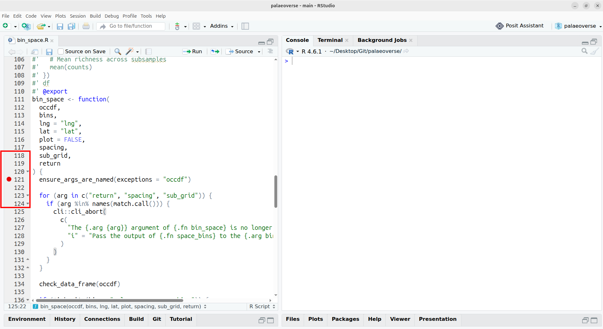

## Objectives

<br>

- Learn the essential steps to debug R code

. . .

- Create a small reproducible example with `reprex`

. . .

- Use `browser()` and breakpoints

## A failing script

<br>

From the ["Latitudinal trends in Phanerozoic reefs"](https://palaeoverse.palaeoverse.org/articles/phanerozoic-reefs.html) vignette:

```{r}
library(palaeoverse)

data(reefs)
reef_counts <- group_apply(occdf = reefs, group = "interval", fun = nrow)
reefs <- look_up(occdf = reefs,
                 early_interval = "interval",
                 late_interval = "interval",
                 int_key = interval_key)
reefs <- subset(reefs, interval_max_ma <= 541)
bins <- time_bins(interval = "Phanerozoic", rank = "stage")

bin_time(occdf = reefs, bins = bins, method = "mid")
```

```
#> Error in `[.data.frame`:
#> ! undefined columns selected
```

## A failing script

<br>

Using `traceback()` to see the chain of errors:

```
> traceback()
4: stop("undefined columns selected")
3: `[.data.frame`(occdf, , max_ma, drop = TRUE)
2: occdf[, max_ma, drop = TRUE]
1: bin_time(occdf = reefs, bins = bins, method = "mid") at #1
```

. . .

<br>

The root cause is not very clear.


# Reducing the problem

## Minimal reproducible example

<br>

- Longer code = more potential causes.

. . .

- First step: build a **repr**oducible **ex**ample, aka a *reprex*.

. . .

- Two steps:

  1. reduce the data
  1. reduce the code

## Reduce the data

<br>

Smaller data:

- runs faster
- makes outputs easier to compare

. . .

<br>

Our dataset has thousands of rows and 14 columns:

```{r}
#| eval: true

library(palaeoverse)
dim(reefs)
```

## Reduce the data

<br>

Keep only the first 6 rows:

```{r}
#| code-line-numbers: "1"

reefs2 <- head(reefs)

reef_counts <- group_apply(occdf = reefs2, group = "interval", fun = nrow)
reefs2 <- look_up(occdf = reefs2,
                  early_interval = "interval",
                  late_interval = "interval",
                  int_key = interval_key)
reefs2 <- subset(reefs2, interval_max_ma <= 541)
bins <- time_bins(interval = "Phanerozoic", rank = "stage")

bin_time(occdf = reefs2, bins = bins, method = "mid")
```

```
#> Error in `[.data.frame`:
#> ! undefined columns selected
```

## Reduce the data

<br>

Keep one row and 5 columns:

```{r}
#| code-line-numbers: "1-2"

reefs2 <- head(reefs, n = 1)
reefs2 <- reefs2[, 1:5]

reef_counts <- group_apply(occdf = reefs2, group = "interval", fun = nrow)
```

```
Error in `group_apply()`:
! Supplied `group` is not a named column in `occdf`
```

## Reduce the data

<br>

Keep one row and 6 columns:

```{r}
#| code-line-numbers: "1-2"

reefs2 <- head(reefs, n = 1)
reefs2 <- reefs2[, 1:6]

reef_counts <- group_apply(occdf = reefs2, group = "interval", fun = nrow)
reefs2 <- look_up(occdf = reefs2,
                  early_interval = "interval",
                  late_interval = "interval",
                  int_key = interval_key)
reefs2 <- subset(reefs2, interval_max_ma <= 541)
bins <- time_bins(interval = "Phanerozoic", rank = "stage")

bin_time(occdf = reefs2, bins = bins, method = "mid")
```

```
#> Error in `[.data.frame`:
#> ! undefined columns selected
```

## Reduce the code

<br>

Remove as much code as possible to limit potential causes.

```{r}
#| code-line-numbers: "|4|9"

reefs2 <- head(reefs, n = 1)
reefs2 <- reefs2[, 1:6]

reef_counts <- group_apply(occdf = reefs2, group = "interval", fun = nrow)
reefs2 <- look_up(occdf = reefs2,
                  early_interval = "interval",
                  late_interval = "interval",
                  int_key = interval_key)
reefs2 <- subset(reefs2, interval_max_ma <= 541)
bins <- time_bins(interval = "Phanerozoic", rank = "stage")

bin_time(occdf = reefs2, bins = bins, method = "mid")
```

## Reduce the code

<br>

- `reef_counts` is never used: remove it.

. . .

- Does `subset()` do anything with one row?

```{r}
identical(reefs2, subset(reefs2, interval_max_ma <= 541))
#> [1] TRUE
```

. . .

- No: remove it too.

## Reduce the code

<br>

What we have now:

```{r}
reefs2 <- head(reefs, n = 1)
reefs2 <- reefs2[, 1:6]

reefs2 <- look_up(occdf = reefs2,
                  early_interval = "interval",
                  late_interval = "interval",
                  int_key = interval_key)
bins <- time_bins(interval = "Phanerozoic", rank = "stage")

bin_time(occdf = reefs2, bins = bins, method = "mid")
```

. . .

Two out of five function calls removed, but still no clear cause.

## Next step

<br>
<br>

Stuck? Ask for help (GitHub, StackOverflow, colleagues).

<br>

. . .

But before that...

# Is your reprex really a reprex?

## Clean the environment

<br>

Our session may contain objects and options unrelated to the problem.

. . .

<br>

They can interact with our code.

. . .

<br>

Restarting R works, but is easy to forget.

## `reprex()`

<br>

[`reprex::reprex()`](https://reprex.tidyverse.org/) runs code in a separate, clean R session.

. . .

<br>

- Errors if the code isn't self-contained.

. . .

- If it runs in `reprex()`, others can reproduce it.

## `reprex()`

<br>

```{r}
reprex::reprex({
  reefs2 <- head(reefs, n = 1)
  reefs2 <- reefs2[, 1:6]

  reefs2 <- look_up(occdf = reefs2,
                    early_interval = "interval",
                    late_interval = "interval",
                    int_key = interval_key)
  bins <- time_bins(interval = "Phanerozoic", rank = "stage")

  bin_time(occdf = reefs2, bins = bins, method = "mid")
})
```

. . .

```
reefs2 <- head(reefs, n = 1)
#> Error:
#> ! object 'reefs' not found
```

## `reprex()`

<br>

```{r}
#| code-line-numbers: "2-3"

reprex::reprex({
  library(palaeoverse)
  data(reefs)
  reefs2 <- head(reefs, n = 1)
  reefs2 <- reefs2[, 1:6]

  reefs2 <- look_up(occdf = reefs2,
                    early_interval = "interval",
                    late_interval = "interval",
                    int_key = interval_key)
  bins <- time_bins(interval = "Phanerozoic", rank = "stage")

  bin_time(occdf = reefs2, bins = bins, method = "mid")
})
```

. . .

```
bin_time(occdf = reefs2, bins = bins, method = "mid")
#> Error in `[.data.frame`:
#> ! undefined columns selected
```

## `reprex()`

<br>

Good practice: add session info with `session_info = TRUE`.

```{r}
#| code-line-numbers: "4"

reprex::reprex({
  library(palaeoverse)
  ...
}, session_info = TRUE)
```

. . .

<br>

Reducing the problem is key, and often reveals the bug by itself.

# Debugging a function

## Debugging a function

<br>

A function runs a whole block of code and only shows the final error.

. . .

<br>

One reflex: add `print()` statements.

. . .

<br>

Better: `browser()` pauses execution *inside* the function.

## Example

<br>

Based on [issue #280](https://github.com/palaeoverse/palaeoverse/issues/280) in `palaeoverse` (now fixed):

```{r}
library(palaeoverse)

occdf <- reefs[1:5, ]
bin_space(occdf = occdf, spacing = 1000, sub_grid = 250, return = TRUE)
```

```
Error in `bin_space()`:
! object 'secondary' not found
```

. . .

<br>

`bin_space()` is a long function: where does it fail?

## `browser()`

<br>

Add `browser()` at the top, reload the function, and rerun the code:

```{r}
#| code-line-numbers: "4"
#| error: true

function (occdf, lng = "lng", lat = "lat", spacing = 100, sub_grid = NULL,
    return = FALSE, plot = FALSE)
{
    browser()
    if (!is.data.frame(occdf)) {
        stop("occdf should be of class dataframe")
    }

    [ MANUALLY TRUNCATED ]

}
```

. . .

Execution stops at `browser()`.

## `browser()`

<br>

- We have access to the function environment.

. . .

- E.g. `sub_grid` is `250`, not its default `NULL`.

. . .

- Press "Enter" to run the next statement.

. . .

- Only the path actually taken is executed (e.g. no `if (FALSE)`).

. . .

- Press "Esc" or run `Q` to exit.

## `browser()`

<br>

Step through until the code fails:

```{r}
occdf <- list(occdf, grid, base_grid, primary, secondary)
```

. . .

<br>

Tip: move `browser()` past lines that are irrelevant.

## Breakpoints

<br>

Built into IDEs like RStudio or Positron.

. . .

<br>

Click left of a line number to add one.

. . .

<br>

Same as `browser()`, without modifying the code.

## Breakpoints

<br>

{fig-alt="A screenshot of RStudio. The left hand side shows the editor with the source code of `bin_space()`. On the left of the line number, a circle filled in red indicates the location of the breakpoint."}

# Conclusion

## Conclusion

<br>

- Reduce the data and the code.

. . .

- Check your reprex with `reprex()`.

. . .

- Inspect functions with `browser()` and breakpoints.

. . .

<br>

Good debugging helps you fix your code and improves bug reports.
