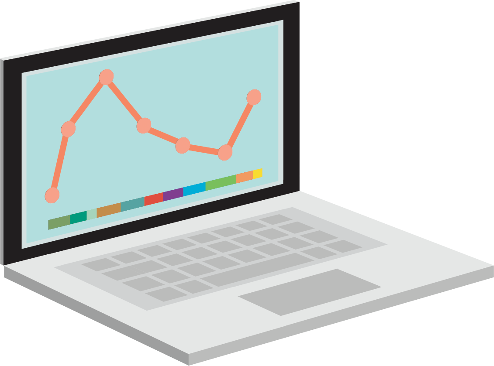
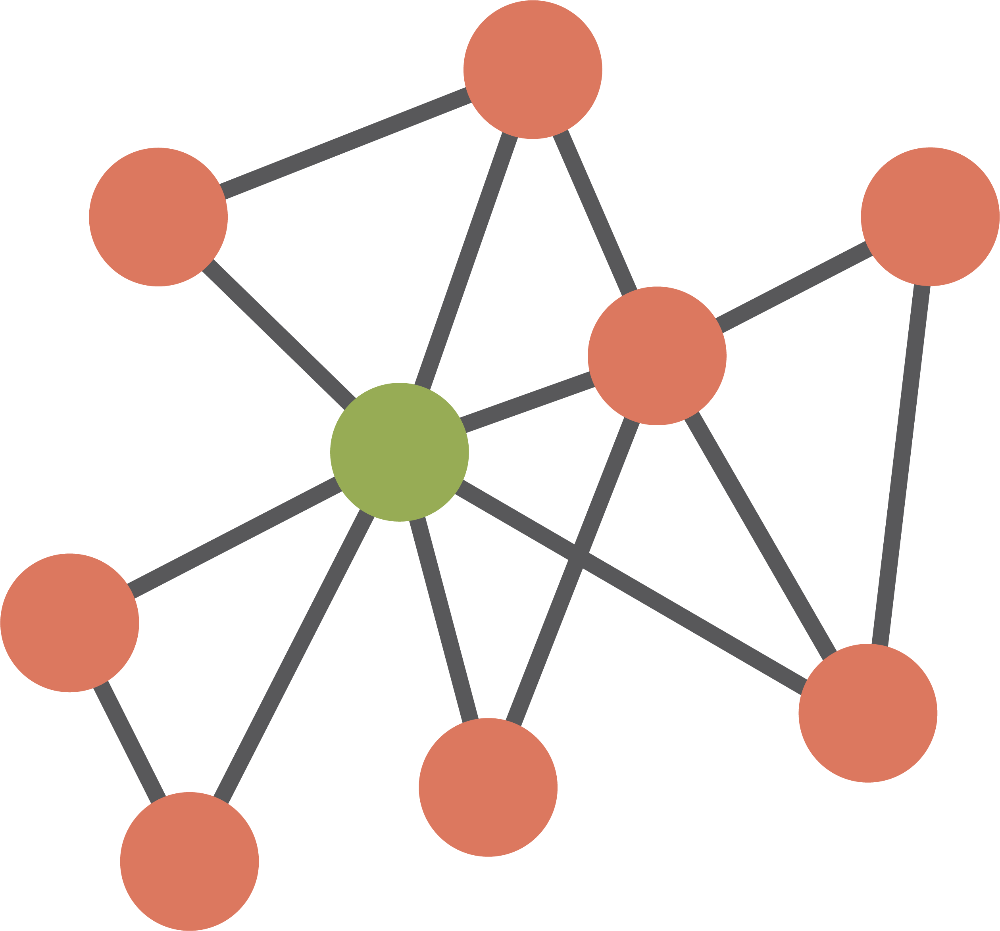

<!-- ENSURE THAT THIS DOCUMENT FOLLOWS THE MODULE STRUCTURE DESCRIBED IN THE GUIDELINES -->

<!-- https://docs.google.com/document/d/16cxSA2bA1MnrnpzmN2yzJNCwJVO7Hm5ceyz10sCmnzY/edit?tab=t.0 -->

## Learning objectives

::: slides-only
1.  Understand what a data management plan is
2.  Know why you might need a data management plan
3.  Know some of the components of a data management plan
:::

::: narration
The learning objectives for this module are to:

1.  Understand what a data management plan is
2.  Know why you might need a data management plan
3.  Know some of the components of a data management plan
:::

## Pre-requisites and related modules

::: slides-only
<!-- UPDATE: titles of modules/numbering -->

No pre-requisites.

Related modules are any that discuss the creation, editing and use of
data, particularly:

- Data acquisition

- Data preparation

- Data cleaning

- Data synthesis

- Archiving

{fig-align="centre" width="300" height="350"}
:::

::: narration
<!-- UPDATE: titles of modules/numbering -->

There are no particular pre-requisites for this module, as the things we
will discuss will be accessible to everyone who has ever handled data at
any level of complexity.

Modules related to this one are any that discuss the creation, editing
and use of data, particularly:

- Data acquisition

- Data preparation

- Data cleaning

- Data synthesis

- Archiving
:::

## Plan for the session

::: slides-only
1.  Discuss what and why of data management plans (DMPs)

2.  Go through a DMP (briefly = taught workshops; detail = asynchronous)

3.  Critique a 'real' DMP
:::

::: narration
The plan for this module is to:

1.  Discuss what a data management plan (DMP) is, and why we might want
    or need to make one

2.  Go through an example of a DMP focused on palaeontological data,
    showing the different contents and decisions you might need to make

3.  Critique an example of a 'real' DMP, to look at what to do or not to
    do
:::

## What is a DMP?

::: slides-only
- Document presenting how data will be managed during and after a
  research project

- Contains details on, for example,:

  - the project in general

  - what types of data will be created and how

  - how will data be documented

  - how data will be stored, including for how long and back-ups

  - whether there are any relevant ethical issues to consider
:::

::: narration
A DMP is a document that presents how data will be created, managed, and
stored during and after a research project. It should therefore contain
details on:

- the project in general (e.g., any funding, relevant parties, a summary
  of the work, etc.)

- what types of data will be created and how, such as spreadsheets,
  photographs, whether existing data will be reused, etc.

- how will data be documented, including metadata

- how data will be stored, including where, for how long, and whether it
  will be backed up

- whether there are any relevant ethical issues to consider, such as
  personal or sensitive data
:::

## Why make a DMP?

::: slides-only
1.  It can help you organise a big project

2.  Prevent data loss, ease sharing of data, support community best
    practices

3.  Many funders require one

{fig-align="right" width="350" height="300"}
:::

::: narration
DMPs are most importantly to help you organise large or complex
projects. They give you the opportunity to think through what data you
will need, the format it will take, and how you will store it in advance
of actually doing the work. They give you a document that you can refer
back to at any time. Overall, this can help you prevent data loss, and
help you share data (both with others and your future self!).
Additionally, many funders of large projects (e.g., the ERC) require you
to submit a DMP, either when you apply to the grant or soon after being
awarded one.
:::

## Components of a DMP

::: narration
We will briefly go through a few essential components of a DMP. These
are loosely organised into sections on data collection, documentation,
storage, and ethical concerns, though the actual headings and structure
you use is up to you (or funder, if they require a specific template to
be used) and can depend on the project.
:::

### Data collection

::: slides-only
- File formats

- Descriptions

- Estimates of volume and times

- Is it reused or generated new?

{fig-align="right" width="400" height="300"}
:::

::: narration
For each type of data you will collect and/or use during your project,
you should briefly include:

- the possible file formats

- a short description of the data

- estimates of data volumes and when the data will be collected during
  the project

- whether the data will all be generated new, or whether (and where
  from) data will be reused
:::

::: slides-only
### Data collection

- How you will generate the new data

- Where data will be reused from

{fig-align="right" width="370" height="300"}
:::

::: narration
For each type of data listed previously, you should then give a brief
description of how you will generate the data (i.e., briefly on the
methods). You should also note where you will reused data from, if
needed (e.g., specific online domain-specific repositories, the
published literature, etc.).
:::

### Data documentation

::: slides-only
- Planned file structure:

  - Predetermined hierarchical file structure

  - Visual summary that you keep up-to-date

- Master (raw) files

  - Always keep a copy of raw data, date-stamped, unedited

- Metadata:

  - README (see Archiving module)

  - Ensure associated protocol or required software is signposted

- Software / code needed to access or run the data

- Domain standards used for data creation / handling
:::

::: narration
You also need to note how your data will be documented. This might
include whether you predetermine a file structure, for which you could
also keep a visual summary so that you never lose anything. This is also
the place to note that you will keep raw versions of created and reused
data files (a good example is PBDB downloads), and how these will be
stored.

You should consider what your metadata will look like, including README
files (see the Archiving module) and how you will signpost to any
relevant protocol or required software for reading/using the data. It is
a good idea to also explicitly state any related tools/software/code
that might be needed for others reusing the data you generate, and how
you will share these.

Lastly, some domains have standards that can/should be used when
generating certain data. You should also consider whether any of these
are applicable to you, and discuss whether you will use them. For
example, for palaeontological occurrence data you might choose to use
the Darwin Core taxonomy (dwc.tdwg.org), and discuss that in your DMP.
:::

### Data storage

::: slides-only
- Repositories for storage

- Open file formats where possible

- Indexing and versioning

- How long will data be preserved for?

- What licenses will data be shared under?

{fig-align="right" width="250" height="250"}
:::

::: narration
There are some incredibly important decisions for you to make and detail
in this section, and having a plan for this before generating data will
really help you. Firstly, you should consider and detail **how you will
store your data**. Of course, we encourage you to store data in places
that it is also easy to share this data (and potentially software), such
as various online repositories (e.g., Zenodo, GitHub, domain-specific
repositories; see the Archiving module). As far as possible, **data
should be stored in these repositories in open file formats** (e.g.,
.csv instead of .xslx), so that proprietary programmes are not needed to
reuse the data. As this point, you should also consider whether the
repositories you choose will allow you to easily index (e.g., through
generation of DOIs) and version-control your data; we advise you to
choose data storage solutions that allow this!

Secondly, you need to think about the lifespan of your data. **How long
will you ensure project data is preserved for?** This might be for as
long as online repositories allow (another point to consider in choosing
a repository), or you might need to commit to a period after the project
in which you keep locally stored data available on request (typically at
least 10 years).

Finally, you should state in your DMP **under which licenses your
generated data (and software) will be shared** (see Archiving module).
Ideally, this would be some CC-BY license to allow maximal reuse (with
attribution) for data, and software license such as GNU for code. You
can also note whether you envisage any embargoes to data sharing (such
as when required by journal publishers), and how you will handle these.
Some repositories, such as Zenodo, allow for embargo periods.
:::

### Ethical considerations

::: slides-only
- Ethical issues with data collection, such as:

  - data from human subjects

  - animal studies

  - personal, confidential, or sensitive data

- Some relevant-to-palaeontology considerations:

  - Sample collecting permits

  - Museum collection restrictions

  - Museum accessioning

  - Sensitive location data

  - Helicopter science / indigenous data

- Data security

{fig-align="right" width="500" height="500"}
:::

::: narration
It is really important that you **consider potential ethical, legal or
security issues regarding your data collection**, even though this
section is likely to be shorter for most palaeontological research than
for some other domains. Mostly palaeontology projects don't need to
consider data derived from human subjects, or that is personal,
confidential, or sensitive, though you should confirm that this is the
case. It is possible that you might be planning studies involving
animals (e.g., experimental taxonomy), and this needs to be carefully
discussed in your DMP. This is not the time or place to go into these
potential ethical concerns, but please search out specific
recommendations if you need to.

However, there are many other ethical considerations to do with
palaeontological data that you should consider here, such as:

- Will you be collecting palaeontological or geological samples? If so,
  you should note about permits in your DMP.

- If the above is true, you should also include what will happen to
  samples after the research. Will they be accessioned in a specific
  museum?

- You might be generating data from existing museum collections - if so,
  you should note that you will discuss sharing of this data with the
  curators in advance, as sometimes the museums have their own
  restrictions.

- Some localities palaeontological and geological data are sourced from
  need to be protected, and so you might state that in these cases
  sensitive location data will not be shared.

- Do you need to consider the impact of your data collection on
  indigenous and local communities? The DMP is a place to discuss these
  ethical concerns, and whether you need to take any action to address
  them (e.g., CARE data).

Lastly, you should briefly **address data security**. Usually
palaeontological data pose a low security risk because there are no
personal or sensitive data, though you should confirm this. Data
security should also factor into your decisions about data storage
locations.
:::

## Resources

- Animal studies: Replace, Reduce, Refine
  <https://nc3rs.org.uk/who-we-are/3rs>
- FAIR data standards <https://www.gofair.foundation/fair-principles>
- CARE data principles for indigenous data
  <https://www.gida-global.org/careprinciples>
- DMP templates and guidance:
  - <https://www.unige.ch/researchdata/application/files/8316/2066/3926/DMP-Checklist.pdf>
  - <https://dmponline.dcc.ac.uk>
  - <https://dmptool.org>

## Activity!

::: narration
Have a look at this DMP. Don't worry too much about the details, but
think about:

1.  What is wrong with this DMP?
2.  How would you improve this DMP?

{width="100%" height="800"}

**30 minutes to read, discuss with your neighbours, and come up with
ways to improve the DMP.** Then we will come back together to talk about
some of the major points.\
Don't hesitate to ask an instructor!
:::

::: slides-only
1.  What is wrong with this DMP?
2.  How would you improve this DMP?

**30 mins to read, discuss, improve!**
:::

### How would you fix this DMP?

::: {.callout-caution collapse="true"}
### What is wrong with this DMP, and how could we improve it? 1

1.  Data collection
    - File format

    - Estimated volumes

    - Any reuse, and detail on which repositories reused data are from

    - How will reused data be cited?
2.  Data documentation
    - More detail on metadata files and folder structure

    - Consider how data will be managed during the project, not just
      archived after

    - More detail on code, whether there are any proprietary file
      formats, etc.
:::

::: {.callout-caution collapse="true"}
### What is wrong with this DMP, and how could we improve it? 2

3.  Data storage
    - More detail on why those repositories, backup plans...

    - Local storage details, institutional servers?

    - Who will data be owned by?
4.  Ethics
    - Potential museum aspects not covered

& who else has access to the data; is it just you who has management
rights?
:::
