::: {.callout-note}
Each step can be done with GitHub Desktop or with `git` on the command line. When the instructions differ, use the tabs to switch between the two. To use GitHub Desktop, you will need to install and setup GitHub Desktop. Follow the instructions [here](index.qmd#prerequisites).
:::

## How does Git work?

Essentially, Git works around two concepts: **repositories** and **commits**.

A Git **repository** is a folder on our computer that we have told the application `git` to keep track of. Any folder can be made into a Git repository!

A Git repository records changes since it started tracking this folder. Changes are organised as **commits**. For instance, the Git history of a folder could look like this:

```{=html}
<pre class="mermaid">
%%{init: {"gitGraph": {"rotateCommitLabel": false, "showBranches": false}}}%%
gitGraph
   commit id: "start using\n git"
   commit id: "add a plot to \n view time bins"
   commit id: "fix a typo in \nthe documentation"
</pre>
```

Our first commit ("start using git") records the state of the folder when we started using Git, our second one could for instance add a script to generate a plot, and our third one fixes a typo. 

Commits are the cornerstone of version control because they allow us to go back to any point, i.e. to recover any *version* of our project.

In this exercise, we will initialise a Git repository on our computer and explore various Git commands with it. In the [second exercise](exercise2.qmd), we will see how to store a Git repository online and how to interact with it. Finally, in the [third exercise](exercise3.qmd), we will see how to collaborate on other people's repositories.

## I. Initialising and adding files

In this section, we will initialise a Git repository from scratch and start tracking some files.

1. Create a new repository called `test-git-repo`:

   ::: {.panel-tabset}
   #### GitHub Desktop

   a. If it's not already open, open GitHub Desktop.

   a. If this is your first time using GitHub Desktop you should see a screen with "Let's get started!" at the top:

      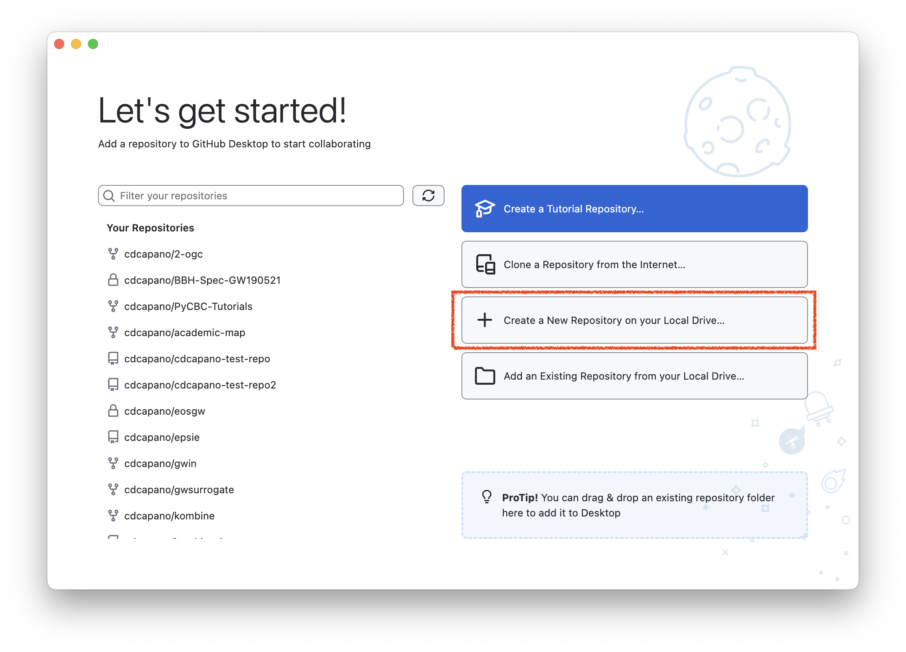

      Click the button titled "Create a New Repository on your Local Drive..."

   a. In the Create a New Repository window, enter `test-git-repo` in the "Name" field, then click "Create Repository". You do not need to fill out any of the other fields.

      ::: {.callout-note}
      By default this will create a local repository in your Documents/GitHub folder. You can change where the repo is located by clicking "Choose". For this tutorial, let's stick with the default.
      :::

   a. You will see a window that has "No local changes" at the top:

      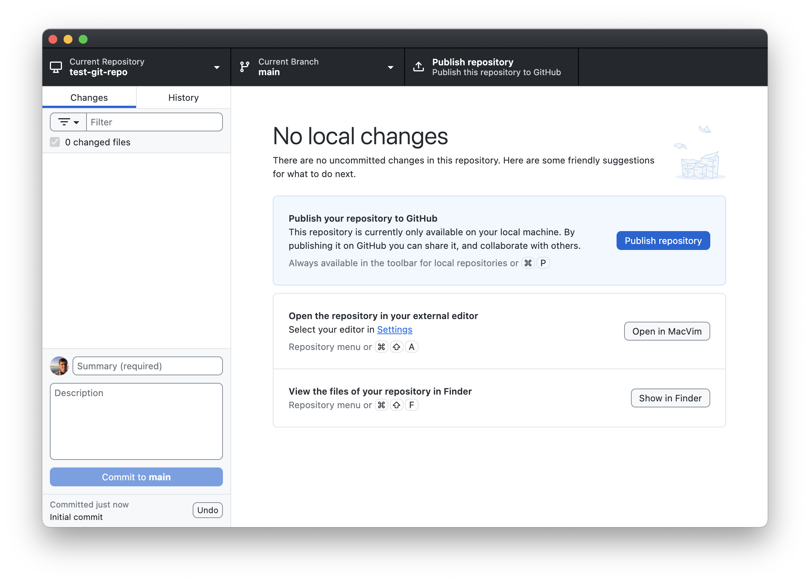

      In the upper left you will see "Current repository" with "test-git-repo" underneath it, indicating that you are currently looking at your test-git-repo. This is how you will interact with your new repository! You can see the repository folder by clicking on the button labelled "Show in Explorer" (on Windows) / "Show in Finder" (on a Mac).

   #### Command line

   Create a folder called `test-git-repo` (here, in your home directory), move into it, and initialise a Git repository in it:

   ```bash
   cd
   mkdir test-git-repo
   cd test-git-repo
   git init
   ```

   `git init` confirms that the repository was created:

   ```txt
   Initialized empty Git repository in /home/you/test-git-repo/.git/
   ```

   `git status` shows:

   ```txt
   On branch main

   No commits yet

   nothing to commit (create/copy files and use "git add" to track)
   ```
   :::

   Note that your repository is a folder on your computer, just like any others. At the moment, there are no files in your repository, although there is a *hidden* folder called `.git` (and, with GitHub Desktop, a *hidden* file called `.gitattributes`). **You never touch these files**; they are what `git` use to keep track of the contents of this folder. These are what make this folder a repository.

1. Let's add some files to your new repository for Git to track. In the following steps, we'll pretend that we're a writer working on a script for a new movie. We're going to use a simple text editor to create a file called `story.txt`. 
   
   ::: {.callout-tip title="How to create a text file?" collapse="true"}
   To do that:

   - **If you're on Windows:**
     a. Open Notepad. This will open a new untitled file.
     a. Click File -> Save As...
     a. Navigate to your repository's directory. If you kept the default path when creating the repository, this should be `PC > Documents > GitHub > test-git-repo`. If you're not certain, you can verify by clicking on the "Show in Explorer" button in GitHub Desktop.
     a. In the "File name" field enter `story.txt` then click "Save".

   - **If you're on MacOS:**
     a. Open TextEdit and click "New Document". This will open a new untitled file.
     a. Select Format -> "Make Plain Text". (We need to do this to get the desired file extension.)
     a. Click File -> Save...
     a. In the "Save As" field type `story.txt`.
     a. In the "Where" field navigate to your repository's directory. If you kept the default path when creating the repository, this should be `Documents/GitHub/test-git-repo`. If you're not certain, you can verify by clicking on the "Show in Finder" button in GitHub Desktop.
     a. Click "Save".
   :::

1. Now let's write our story! Use your text editor to add following to `story.txt`:

   ```
   Once upon a time, in a land far,
   far away...
   ```

   ::: {.callout-warning}
   Type the lines in exactly as they appear above: add a new line after the first "far,". For reasons that will become clear below, it's important that the "far away..." is on a separate line.
   :::

1. Save your changes by clicking File -> Save, or by using the keyboard shortcut <kbd>Ctrl</kbd>+<kbd>S</kbd> (on Windows) / <kbd>&#8984;</kbd>+<kbd>S</kbd> (on Mac).

1. Let's see what Git thinks of this new file:

   ::: {.panel-tabset}
   #### GitHub Desktop

   Go back to GitHub Desktop. You'll notice that it has changed from "No local changes" to showing a "Changes" tab with `story.txt` listed with its contents:

   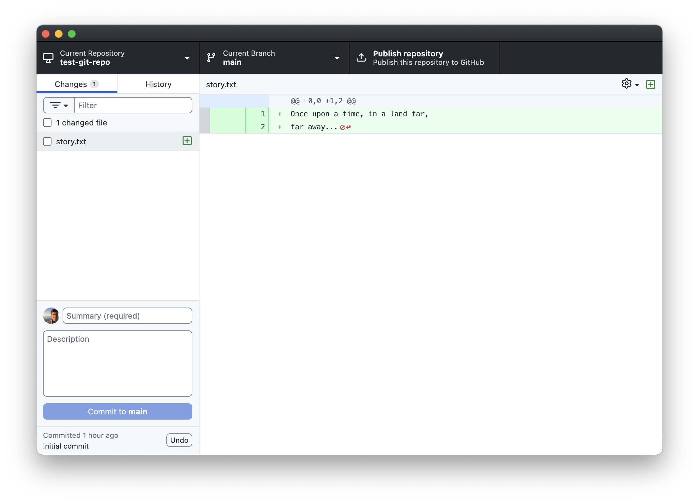

   #### Command line

   ```bash
   git status
   ```

   ```txt
   On branch main

   No commits yet

   Untracked files:
     (use "git add <file>..." to include in what will be committed)
           story.txt

   nothing added to commit but untracked files present (use "git add" to track)
   ```
   :::

   `git` knows you have a file in the directory called `story.txt`, but it isn't tracking it yet!

1. Let's tell `git` to start tracking `story.txt` by making a *commit*. Each commit has a *commit message*: this is text that will be added to the commit describing what was done. Here, we'll use "Create story.txt".

   ::: {.panel-tabset}
   #### GitHub Desktop

   If it isn't already, click the box next to "1 changed file". When you do, you'll notice that the "Summary (required)" box automatically changes to "Create story.txt":

   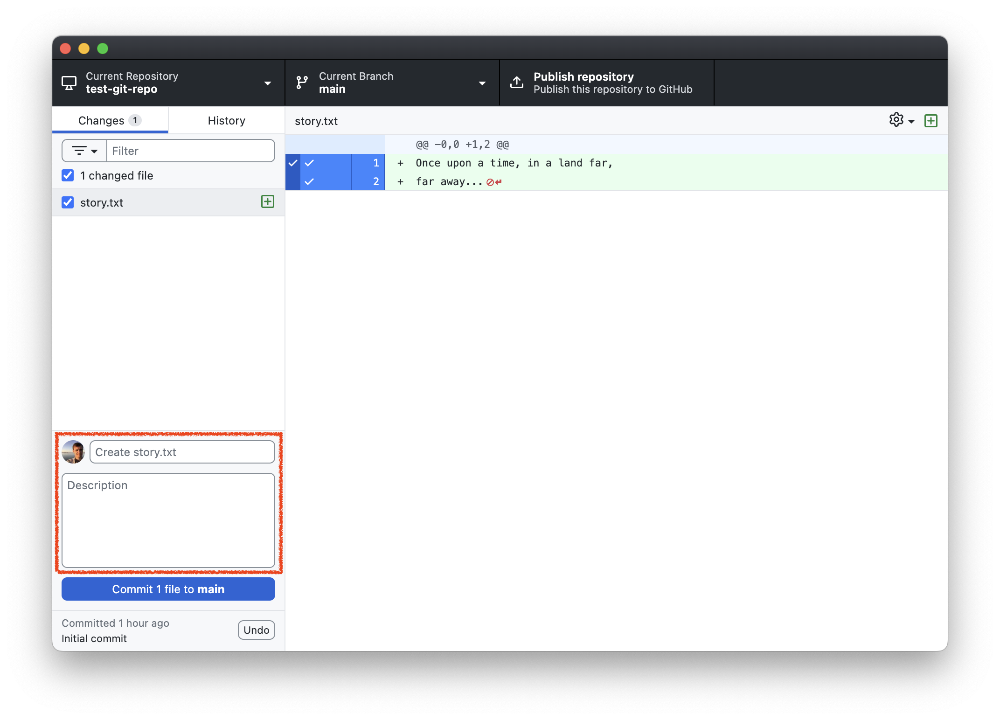

   The summary box and the optional "Description" box below constitute the commit message. In this case, GitHub Desktop automatically provides a default message of "Create story.txt". That's a good description of what we've done, so let's keep it.

   Now click the "Commit 1 file to main" button. When you do, the window will automatically change back to "No local changes".

   #### Command line

   First, *stage* `story.txt`, i.e. add it to the next commit, then commit it:

   ```bash
   git add story.txt
   git commit -m "Create story.txt"
   ```

   `git commit` prints a summary of the commit. `17b2095` is the start of its hash, which identifies it (yours will be different):

   ```txt
   [main (root-commit) 17b2095] Create story.txt
    1 file changed, 2 insertions(+)
    create mode 100644 story.txt
   ```

   It also tells us how many files changed and how many lines were added or removed (here, we only added lines).

   `git status` now says:
   
   ```
   On branch main
   nothing to commit, working tree clean
   ```
   :::

   Congratulations, you've made your first Git commit!

   ::: {.callout-tip title="What happens when you commit changes?"}
   A commit creates a snapshot of the files you committed. Every commit has a commit message, an author, and a unique hash identifying that change. Git keeps a *history* of all commits made in a repository. 
   :::

1. You can view the history of your commits:

   ::: {.panel-tabset}
   #### GitHub Desktop

   Click on the "History" tab:

   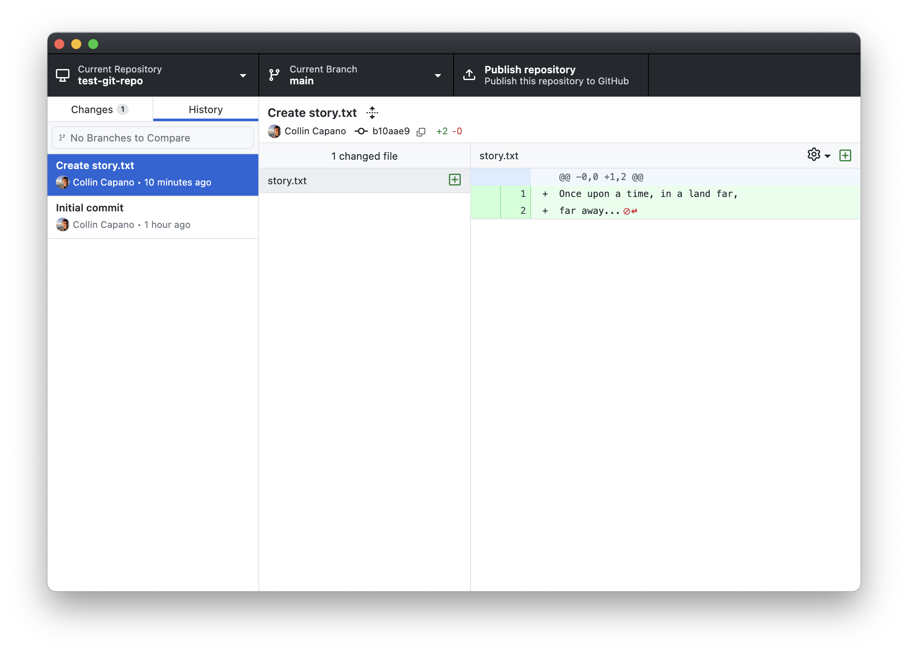

   In this case, there are two commits: an initial commit that was created by GitHub Desktop when the repository was created, and the commit you just made to create `story.txt`.

   #### Command line

   ```bash
   git log
   ```

   ```txt
   commit 17b2095e7b6ed25600be638ed5f02749ddb94a3d (HEAD -> main)
   Author: Your Name <you@example.com>
   Date:   Tue Oct 6 10:03:00 2026 +0200

       Create story.txt
   ```

   Unlike GitHub Desktop, `git init` doesn't create an "Initial commit", so there is only the commit you just made.
   :::

::: {.callout-note title="Graph view"}
```{=html}
<pre class="mermaid">
%%{init: {"gitGraph": {"rotateCommitLabel": false, "showBranches": false}}}%%
gitGraph
   commit id: "Initial commit"
   commit id: "Create story.txt"
</pre>
```
:::

We created a file, which is a type of change that can be tracked by Git. However, its real strength is to track changes within files so that we can clearly see which parts have been created, deleted, or modified. 

In the next section, we will modify some of our existing files and see how to record these changes.

## II. Making changes to files

You're not happy with your story opening. You don't want to write fairy tales, you want to write Sci-fi! 

1. Go back to your text editor `story.txt` and change the line `Once upon a time, in a land far,` to `A long time ago in a galaxy far,` so that your file now reads:

   ```
   A long time ago in a galaxy far,
   far away...
   ```

   Much better. Save the changes to the file.

   ::: {.callout-warning title="Saving is not committing!"}
   Simply saving changes to a file will not result in a new snapshot of it! To tell Git to create a snapshot for preservation **you have to create a commit.** If you make further changes to your file without committing in between, the intermediate changes will not be tracked.
   :::

1. Let's see what lines have changed in `story.txt` since the last commit. This is called a *diff*:

   ::: {.panel-tabset}
   #### GitHub Desktop

   Go back to GitHub Desktop. Notice that a yellow box with a dot has appeared next to `story.txt`. If you click on story, you should now see the diff:

   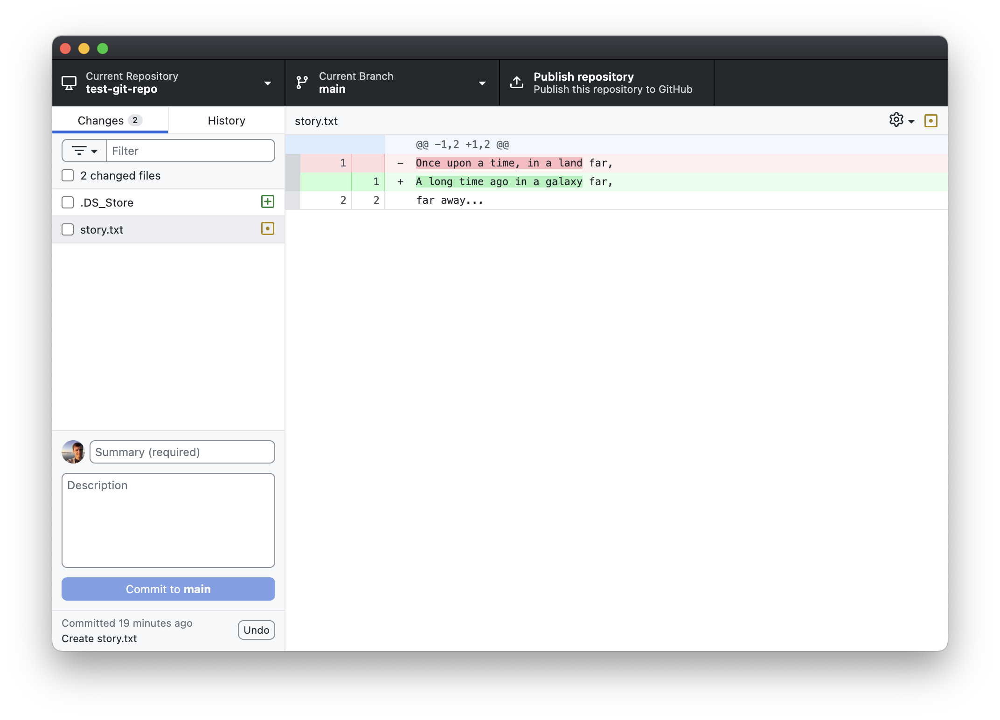

   ::: {.callout-warning title="Those pesky .DS_Store files on MacOS" collapse="true"}
   At some point Mac users will notice a file called `.DS_Store` appears in their repo, as it did for me in the screen shot above. This is a hidden file that MacOS automatically creates in every folder for indexing purposes. **Do not commit this file to your repository!** It's not something you want to track. For now, just ignore it. Below we provide instructions on how to permanently ignore files like these in your repository.

   Windows users: carry on.
   :::

   #### Command line

   ```bash
   git diff
   ```

   ```txt
   diff --git a/story.txt b/story.txt
   index ceb7be2..577687e 100644
   --- a/story.txt
   +++ b/story.txt
   @@ -1,2 +1,2 @@
   -Once upon a time, in a land far,
   +A long time ago in a galaxy far,
    far away...
   ```

   There is a lot of info here, but the important part is:

   ```
   -Once upon a time, in a land far,
   +A long time ago in a galaxy far,
   ```

   which tells us which line was removed (starting with `-`) and which line was added (starting with `+`).
   :::

1. Git recognizes that `story.txt` has changed, *but your changes have not been committed yet.*

   ::: {.panel-tabset}
   #### GitHub Desktop

   This is what the yellow box next to `story.txt` means. If you go to the History tab, you'll see that there are still only two commits. If you click on the "Create story.txt" commit, it will show the previous state of the file.

   #### Command line

   `git status` tells us that a file has been modified but is not ready to be committed yet:
   ```txt
   On branch main
   Changes not staged for commit:
     (use "git add <file>..." to update what will be committed)
     (use "git restore <file>..." to discard changes in working directory)
           modified:   story.txt

   no changes added to commit (use "git add" and/or "git commit -a")
   ```
   :::

1. Let's commit your changes so you don't lose them! This time, let's give a more descriptive commit message: "Change opening".

   ::: {.panel-tabset}
   #### GitHub Desktop

   Click the check box next to `story.txt`. When you do, GitHub Desktop will automatically change the summary to "Update story.txt". That is a description of what we did, but it's not very informative. Change the summary to "Change opening", then click "Commit 1 file to main":

   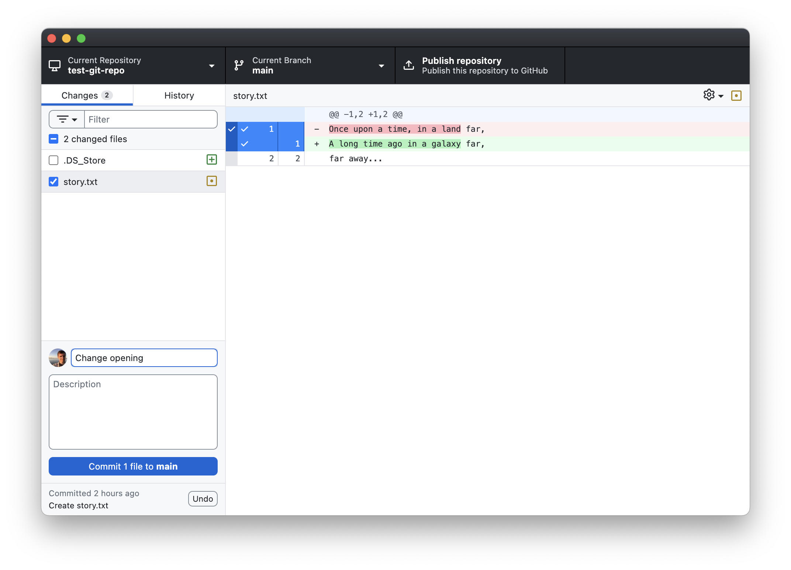

   You'll now see 3 commits in your history.

   #### Command line

   ```bash
   git add story.txt
   git commit
   ```

   Without `-m`, `git commit` opens a text editor to write the commit message, which is handy for multi-line messages. Type "Change opening", then save and exit to complete the commit:

   ```txt
   [main b81e803] Change opening
    1 file changed, 1 insertion(+), 1 deletion(-)
   ```

   `git log` now shows 2 commits. `git log --oneline` shows a more compact version of the history, with one line per commit:

   ```txt
   b81e803 Change opening
   17b2095 Create story.txt
   ```
   :::

::: {.callout-note title="Graph view"}
```{=html}
<pre class="mermaid">
%%{init: {"gitGraph": {"rotateCommitLabel": false, "showBranches": false}}}%%
gitGraph
   commit id: "Initial commit"
   commit id: "Create story.txt"
   commit id: "Change opening"
</pre>
```
:::

### Ignoring changes in some files

It frequently happens that you can have files in your repository that you don't want Git to track. This can be things like temporary build files, or system files like the `.DS_Store` on Macs. If you don't explicitly commit a new file (by clicking the check mark next to it and hitting the commit button), then files won't be tracked. However, trying to avoid clicking these files can be tedious and error prone. You'll also get warnings about changes every time you switch branches (below).

We can tell Git to ignore certain files by storing their names in a special file called `.gitignore`. Here, we'll tell it to ignore the `.DS_Store` file created by MacOS.

:::: {.callout-note title="Windows users" collapse="true"}
Windows users will not have a `.DS_Store` file or any other hidden file created by the OS as on Mac. To follow along in this part, create an empty file in your repository called `.DS_Store`:

::: {.panel-tabset}
#### GitHub Desktop

a. Switch back to Notepad.

b. Create a new file by typing <kbd>Ctrl</kbd>+<kbd>N</kbd>. This will open a new Untitled file that is empty.

c. Click File -> Save.

d. In the "Save as type" field click the drop-down menu and select "All files".

e. In the File name field type `.DS_Store.`. **Note the trailing period!** That is, enter `.DS_Store.` not `.DS_Store` -- if you don't include the period at the end of the file name, Windows will automatically add `.txt` to the end.

f. Click "Save"

#### Command line

```bash
touch .DS_Store
```
:::
::::

To tell Git to ignore a file:

1. Add the file you'd like it to ignore, in this case `.DS_Store`, to `.gitignore`:

   ::: {.panel-tabset}
   #### GitHub Desktop

   Right-click `.DS_Store`. On the drop-down menu, select "Ignore file (Add to .gitignore)":

   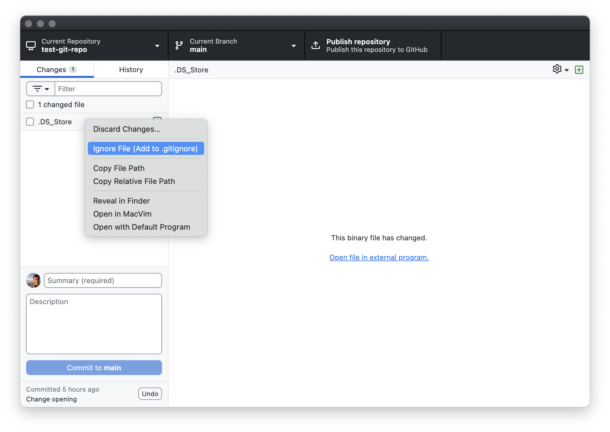

   #### Command line

   ```bash
   echo ".DS_Store" >> .gitignore
   ```

   This creates `.gitignore` if it doesn't exist.
   :::

1. `.DS_Store` no longer appears in the changes. In its place, you'll see a `.gitignore` file has been created. The `.gitignore` file is a simple text file that lists the names of any files in the repository that you want Git to ignore.

   ::: {.panel-tabset}
   #### GitHub Desktop

   Notice that GitHub Desktop has both created the file, and added `.DS_Store` to it:

   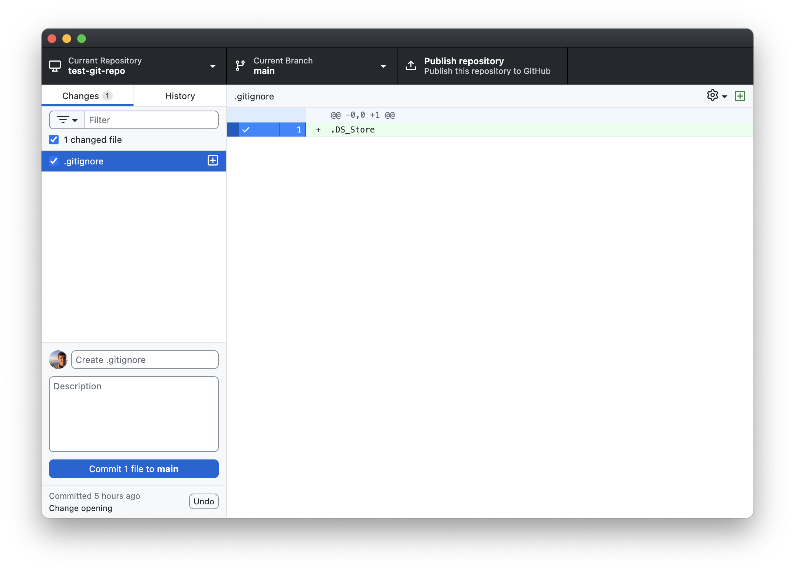

   #### Command line

   Check this with `git status`:

   ```txt
   On branch main
   Untracked files:
     (use "git add <file>..." to include in what will be committed)
           .gitignore

   nothing added to commit but untracked files present (use "git add" to track)
   ```
   :::

1. As with any other file, we need to commit the changes to `.gitignore` for Git to keep track of it, here with the message "Create .gitignore":

   ::: {.panel-tabset}
   #### GitHub Desktop

   Commit the change by clicking the "Commit 1 file to main" (note that the commit message automatically created by GitHub Desktop is "Create .gitignore").

   #### Command line

   ```bash
   git add .gitignore
   git commit -m "Create .gitignore"
   ```

   ```txt
   [main 40d5b63] Create .gitignore
    1 file changed, 1 insertion(+)
    create mode 100644 .gitignore
   ```
   :::

::: {.callout-note title="Graph view"}
```{=html}
<pre class="mermaid">
%%{init: {"gitGraph": {"rotateCommitLabel": false, "showBranches": false}}}%%
gitGraph
   commit id: "Initial commit"
   commit id: "Create story.txt"
   commit id: "Change opening"
   commit id: "Create .gitignore"
</pre>
```
:::

From now on, any file named `.DS_Store` in this repository (meaning, in this folder and all sub-folders) file will not appear in your Changes menu, nor will you be able to commit changes to it to the repository.

## III. Branches

You want to start working on titles for your stories, but you have a feeling that imagining the perfect title will take several iterations. 

We could continue to make new commits as we come up with new ideas, but this would quickly lead to a messy Git history. This is not always a big deal, but Git is here to enable us to quickly go back to previous versions, and it is easier to locate a correct version when we don't have to navigate dozens of commits containing intermediate changes. 

In other words, we would like to keep our work on titles separate from our work on the story itself, and only integrate the titles when we are finally happy with them. 

This will require introducing a new key concept in the usual Git workflow: **branches**.

### What is a branch?

A branch is a sort of parallel environment where we can push our commits. A Git project can have as many branches as you want. 

The graphs we have been seeing so far were slightly misleading. In reality, we always commit to a branch (by default, we commit to the `main` branch):

```{=html}
<pre class="mermaid">
%%{init: {"gitGraph": {"rotateCommitLabel": false}}}%%   
gitGraph
   commit id: "Initial commit"
   commit id: "Create story.txt"
   commit id: "Change opening"
   commit id: "Create .gitignore"
</pre>
```

### Creating a new branch

When we create a new branch, we separate our future commits from the `main` branch. For instance, we could create a branch `title-dev` that will receive all our commits about the stories titles:

```{=html}
<pre class="mermaid">
%%{init: {"gitGraph": {"rotateCommitLabel": false}}}%%   
gitGraph
   commit id: "Initial commit"
   commit id: "Create story.txt"
   commit id: "Change opening"
   commit id: "Create .gitignore"
   branch title-dev
   commit id: "Create title.txt"
</pre>
```

Let's see how to do this in practice:

1. Let's look at the branches of your repository:

   ::: {.panel-tabset}
   #### GitHub Desktop

   Click on the "Current Branch" tab. This will show a drop-down menu showing all of the branches on your repository:

   

   #### Command line

   ```bash
   git branch
   ```

   ```txt
   * main
   ```

   The `*` marks the branch you are on.
   :::

   Currently, we only have one branch, which is called `main` by default, as mentioned above. Think of it as the master copy of your repository. If this were a code repository, the `main` would be the branch that you (try to) keep a clean, working version of your code.

1. Let's create our new branch, named `title-dev`, on which we will develop our title, and switch to it:

   ::: {.panel-tabset}
   #### GitHub Desktop

   Click the "New Branch" button in the upper right. You will be prompted to create a name. Call it `title-dev`, then click "Create Branch":

   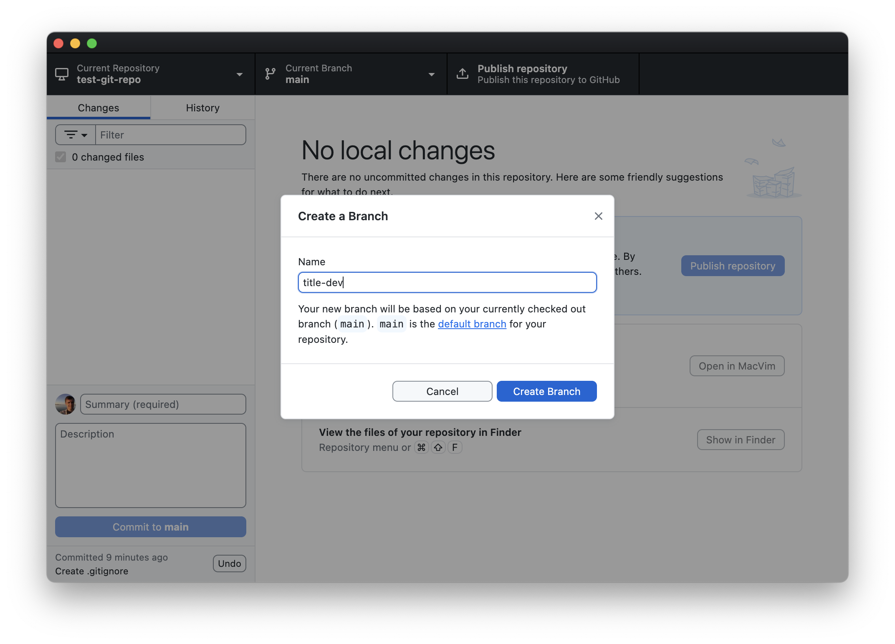

   You are now on a new branch called `title-dev`. You can see that by looking at the Current Branch at the top: it says title-dev:

   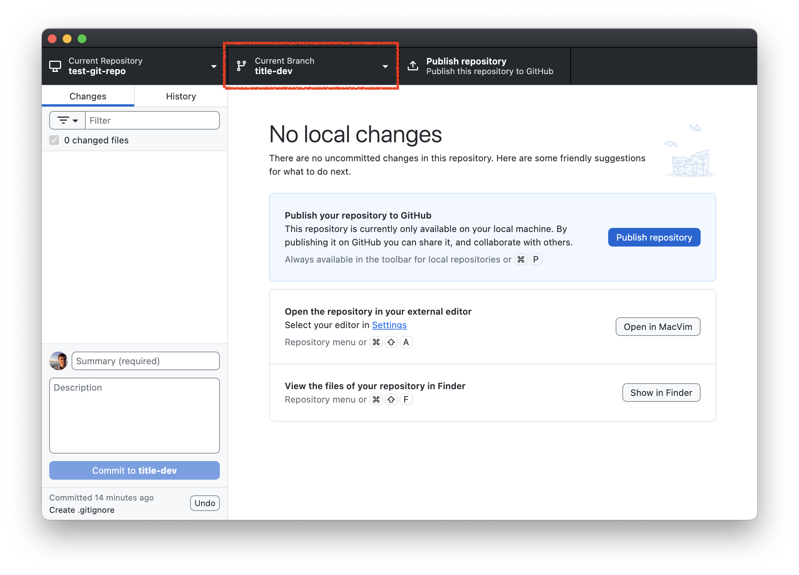

   #### Command line

   `git checkout` allows us to navigate between existing branches. In this case, we use `-b` to create the branch first, and then navigate to it:

   ```bash
   git checkout -b title-dev
   ```

   ```txt
   Switched to a new branch 'title-dev'
   ```

   You are now on a new branch called `title-dev`, as shown by `git branch`:

   ```txt
     main
   * title-dev
   ```
   :::

1. Let's do some development on `title-dev`. Now let's create a file called `title.txt` to store our title idea.

   ::: {.callout-tip title="How to create a new text file?" collapse="true"}

   - **Windows users:**
     a. Switch back to Notepad.
     a. Type <kbd>Ctrl</kbd>+<kbd>N</kbd> to create a new untitled file.
     a. Click File -> Save
     a. In the "File name" field enter `title.txt` then click "Save".

   - **Mac users:**
     a. Switch back to TextEdit.
     a. Type <kbd>&#8984;</kbd>+<kbd>N</kbd> to create a new untitled file.
     a. Select Format -> "Make Plain Text". (We need to do this to get the desired file extension.)
     a. Click File -> Save...
     a. In the "Save As" field type `title.txt`.
     a. Click "Save".
   :::

1. Add a title to `title.txt`. Use your text editor to add:

   ```
   STAR FIGHT!
   ```

   Save the change by typing <kbd>Ctrl</kbd>+<kbd>S</kbd> (Windows) / <kbd>&#8984;</kbd>+<kbd>S</kbd> (Mac).

1. Commit the new file with the message "Create title.txt":

   ::: {.panel-tabset}
   #### GitHub Desktop

   Go back to GitHub Desktop. You should see `title.txt` in the Changes sidebar, with the new lines shown in the diff:

   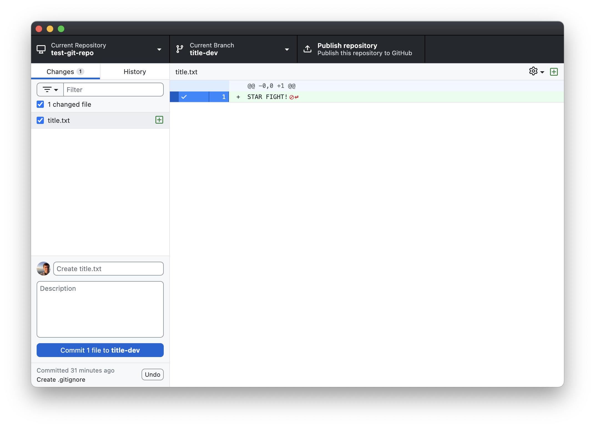

   Commit the new changes by clicking "Commit 1 file to title-dev". Note the default commit message is "Create title.txt".

   #### Command line

   ```bash
   git add title.txt
   git commit -m "Create title.txt"
   ```

   ```txt
   [title-dev 0517538] Create title.txt
    1 file changed, 1 insertion(+)
    create mode 100644 title.txt
   ```

   Note that the summary starts with `title-dev`: this is the branch on which the commit was made.
   :::

::: {.callout-note title="Graph version"}
```{=html}
<pre class="mermaid">
%%{init: {"gitGraph": {"rotateCommitLabel": false}}}%%   
gitGraph
   commit id: "Initial commit"
   commit id: "Create story.txt"
   commit id: "Change opening"
   commit id: "Create .gitignore"
   branch title-dev
   commit id: "Create title.txt"
</pre>
```
:::

### Navigating branches

We don't have to be stuck on a branch until its changes are integrated in the `main` branch, we can navigate between branches!

1. Satisfied with your title for now, go back to your main branch:

   ::: {.panel-tabset}
   #### GitHub Desktop

   You can switch between branches by clicking the "Current Branch" drop-down menu, then selecting the branch you want. Select `main`:

   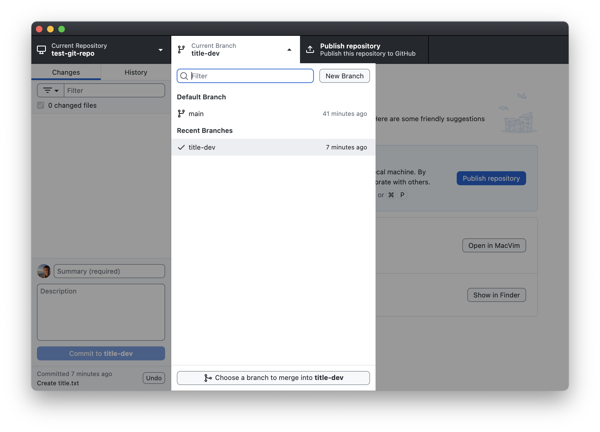

   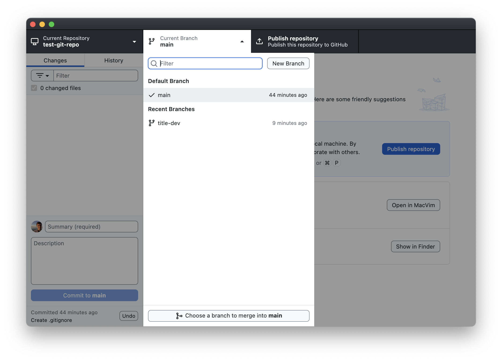

   #### Command line

   ```bash
   git checkout main
   ```

   ```txt
   Switched to branch 'main'
   ```
   :::

1. Let's see what happened to your files and history when you switched back to `main`:

   ::: {.panel-tabset}
   #### GitHub Desktop

   If you still have the Explorer/Finder window open, look at it. If not, click the "Show in Explorer" (Windows) / "Show in Finder" (Mac) button to view the contents of the repository. The `title.txt` file is gone! Likewise, if you click on the "History" tab in GitHub Desktop, you'll see that your last commit is no longer in your history; you just have the first four commits.

   #### Command line

   ```bash
   ls
   ```

   ```txt
   story.txt
   ```

   ```bash 
   git log --oneline
   ```

   ```txt
   40d5b63 Create .gitignore
   b81e803 Change opening
   17b2095 Create story.txt
   ```

   The `title.txt` file is gone! Likewise, your last commit is no longer in your history; you just have the first three commits.
   :::

   This is because your last commit (and the file it created, `title.txt`) only exists on the `title-dev` branch. To verify that it's still there, switch to the `title-dev` branch: you'll see the "Create title.txt" commit reappear in your history.

   Since the commits on `title-dev` live on their own branch, changes you make on `main` won't affect `title-dev` and vice versa (at least not until we merge the branches, more on that below).

1. Let's make some more changes to `story.txt`, but let's do it on the `main` branch. Switch back to `main`. Now use your text editor to add the following lines to `story.txt`:

   ```

   It is period of civil war.
   Rebel spaceships, striking
   from a hidden base, have won
   their first victory against
   the evil Galactic Empire.
   ```

1. Commit the changes with the message "Add first paragraph":

   ::: {.panel-tabset}
   #### GitHub Desktop

   Stage the commit by clicking the check mark next to `story.txt` in GitHub Desktop and change the commit message to "Add first paragraph":

   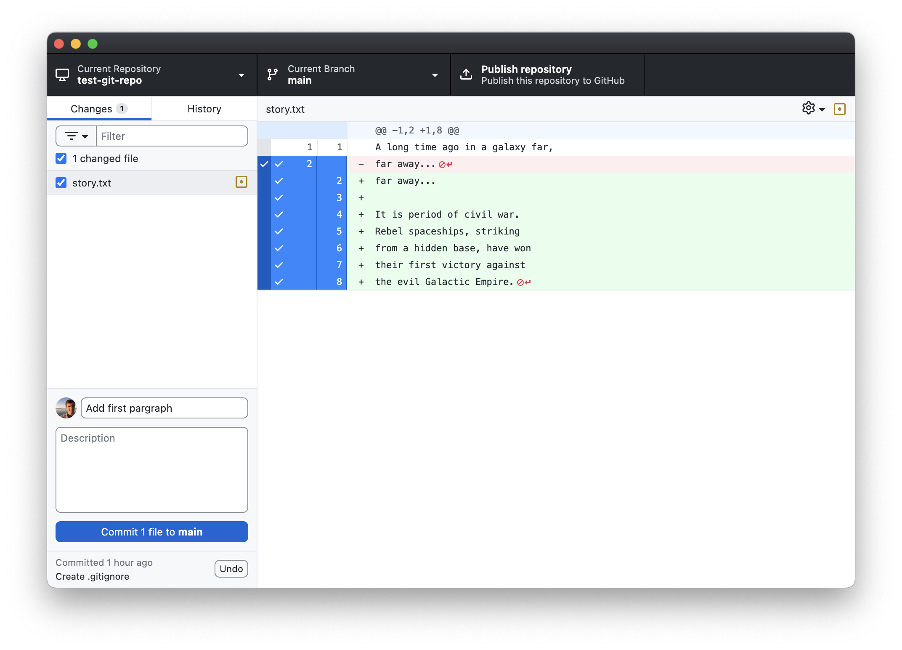

   Now commit the changes by clicking "Commit 1 file to main".

   #### Command line

   ```bash
   git add -u
   git commit -m "Add first paragraph"
   ```

   `git add -u` stages the changes of all tracked files.

   ```txt
   [main c1d82b6] Add first paragraph
    1 file changed, 6 insertions(+)
   ```
   :::

1. Look at the history of `main`: none of its commits include the commits to `title-dev` branch.

   ::: {.panel-tabset}
   #### GitHub Desktop

   Click on the History tab. Note that you now have 5 commits on master.

   #### Command line

   ```bash
   git log --oneline
   ```

   ```txt
   c1d82b6 Add first paragraph
   40d5b63 Create .gitignore
   b81e803 Change opening
   17b2095 Create story.txt
   ```

   ::: {.callout-tip title="Graph view in the terminal" collapse="true"}
   Add `--graph` to `git log` to see the history as a graph, and `--all` to include all branches:

   ```bash
   git log --oneline --graph --all
   ```

   ```txt
   * c1d82b6 Add first paragraph
   | * 0517538 Create title.txt
   |/
   * 40d5b63 Create .gitignore
   * b81e803 Change opening
   * 17b2095 Create story.txt
   ```
   :::
   :::

::: {.callout-note title="Graph version"}
```{=html}
<pre class="mermaid">
%%{init: {"gitGraph": {"rotateCommitLabel": false}}}%%
gitGraph
   commit id: "Initial commit"
   commit id: "Create story.txt"
   commit id: "Change opening"
   commit id: "Create .gitignore"
   branch title-dev
   commit id: "Create title.txt"
   checkout main
   commit id: "Add first pargraph"
</pre>
```
:::

1. In a flash of brilliance, you get an idea for the title of your story. Quick! Switch to your `title-dev` branch.

   ::: {.panel-tabset}
   #### GitHub Desktop

   Click the "Current Branch" drop-down menu, and select `title-dev`.

   #### Command line

   ```bash
   git checkout title-dev
   ```

   ```txt
   Switched to branch 'title-dev'
   ```
   :::

   Now use your text editor to edit `title.txt` and change `STAR FIGHT!` to:

   ```
   Star Wars
   A NEW HOPE

   by
   George Lucas
   ```

   Nice work, George!

1. Save your changes to `title.txt` and commit them with the message "Update title.txt":

   ::: {.panel-tabset}
   #### GitHub Desktop

   Stage the changes in GitHub Desktop by clicking the check box next to `title.txt`. Commit the changes by clicking the "Commit 1 file to title-dev":

   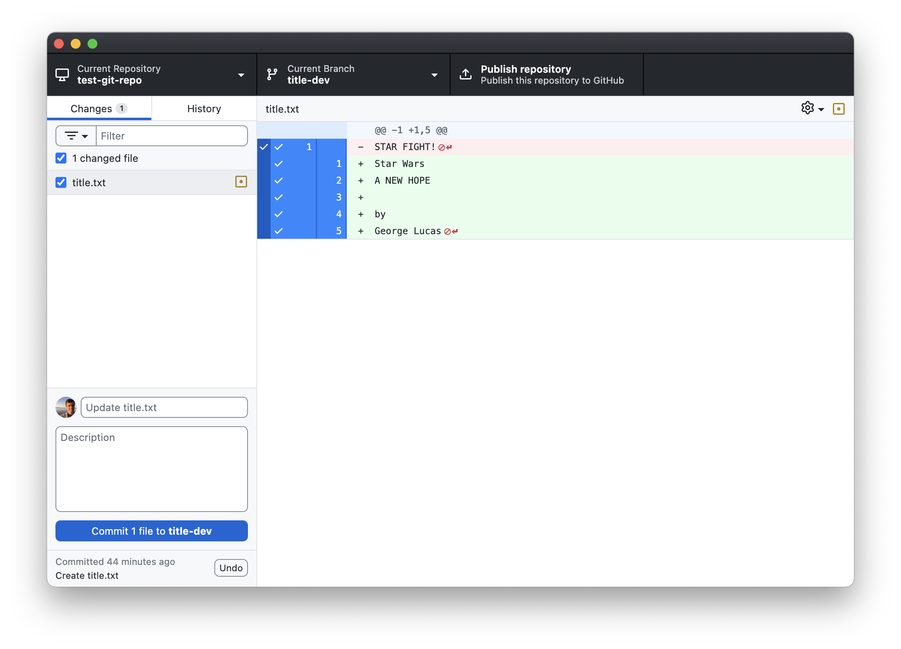

   Note that the commit message is "Update title.txt".

   #### Command line

   ```bash
   git add -u
   git commit -m "Update title.txt"
   ```

   ```txt
   [title-dev 1b45d74] Update title.txt
    1 file changed, 5 insertions(+), 1 deletion(-)
   ```
   :::

1. The history of `title-dev` contains the commits from `main` before you branched off, and the last two on `title-dev`:

   ::: {.panel-tabset}
   #### GitHub Desktop

   Click on the History tab. Note that there are 6 commits here: the first four from `main`, and the last two on `title-dev`:

   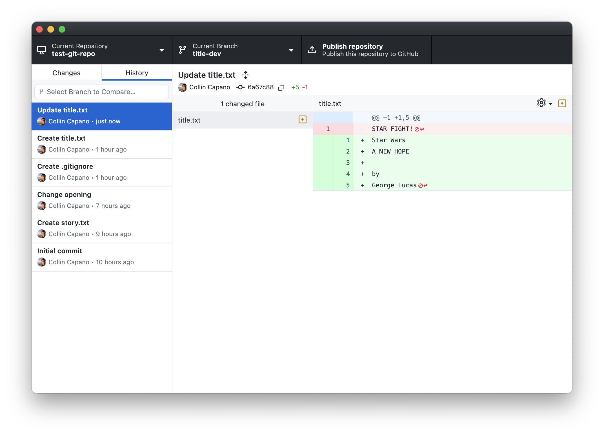

   #### Command line

   `git log --oneline` shows 5 commits: the first three from `main`, and the last two on `title-dev`:

   ```txt
   1b45d74 Update title.txt
   0517538 Create title.txt
   40d5b63 Create .gitignore
   b81e803 Change opening
   17b2095 Create story.txt
   ```
   :::

::: {.callout-note title="Graph version"}
```{=html}
<pre class="mermaid">
%%{init: {"gitGraph": {"rotateCommitLabel": false}}}%%   
gitGraph
   commit id: "Initial commit"
   commit id: "Create story.txt"
   commit id: "Change opening"
   commit id: "Create .gitignore"
   branch title-dev
   commit id: "Create title.txt"
   checkout main
   commit id: "Add first paragraph"
   checkout title-dev
   commit id: "Update title.txt"
</pre>
```
:::

### Merging

We have done some work on the title in parallel to the work on the story itself, and we finally found a great title that we don't plan to change. It is now time to integrate our changes on the title back into the `main` branch. In more common Git vocabulary, it is time to **merge** our branch.

First, we will create a backup of the `main` branch, just in case something goes wrong. Some mistakes in Git usage can be notoriously hard to debug, so making a clean backup before a big operation like merging can be useful.

1. First, let's switch to the `main` branch.

   ::: {.panel-tabset}
   #### GitHub Desktop

   Click the "Current Branch" drop-down menu, and select `main`.

   #### Command line

   ```bash
   git checkout main
   ```

   ```txt
   Switched to branch 'main'
   ```
   :::

1. We will call our backup `main-bkup`. This way, you have the original state of `main` preserved in the backup branch that you can always go back to.

   To create the copy of `main`:

   ::: {.panel-tabset}
   #### GitHub Desktop

   a. Click Current Branch. Make sure you're on `main` (the checkmark is next to `main`), then click "New Branch":

      

   b. This will open the "Create a Branch" window. Type `main-bkup` in the Name field, then click "Create Branch". You will now be on the `main-bkup` branch.

   c. Now go back to the `main` branch by clicking "Current Branch -> main".

   #### Command line

   ```bash
   git branch main-bkup
   ```

   Unlike `git checkout -b`, `git branch` creates the branch without switching to it, so you stay on `main`.
   :::

::: {.callout-note title="Graph version"}
```{=html}
<pre class="mermaid backup-on-top">
%%{init: {"gitGraph": {"rotateCommitLabel": false, "mainBranchOrder": 1}}}%%
gitGraph
   commit id: "Initial commit"
   commit id: "Create story.txt"
   commit id: "Change opening"
   commit id: "Create .gitignore"
   branch title-dev order: 2
   commit id: "Create title.txt"
   checkout main
   commit id: "Add first paragraph"
   checkout title-dev
   commit id: "Update title.txt"
   checkout main
   branch main-bkup order: 0
</pre>
```
:::

1. Now let's merge `title-dev` into `main`:

   ::: {.panel-tabset}
   #### GitHub Desktop

   a. Click the Current Branch drop-down menu again, and this time click the "Choose a branch to merge into *main*" button:

      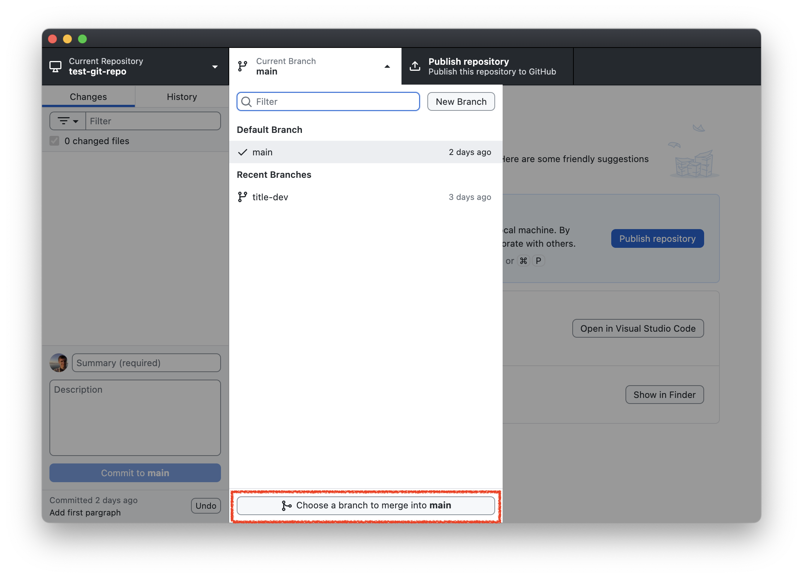

   a. Select the `title-dev` branch. The button at the bottom will turn to blue and say "Create a merge commit". Click that to merge the branch:

      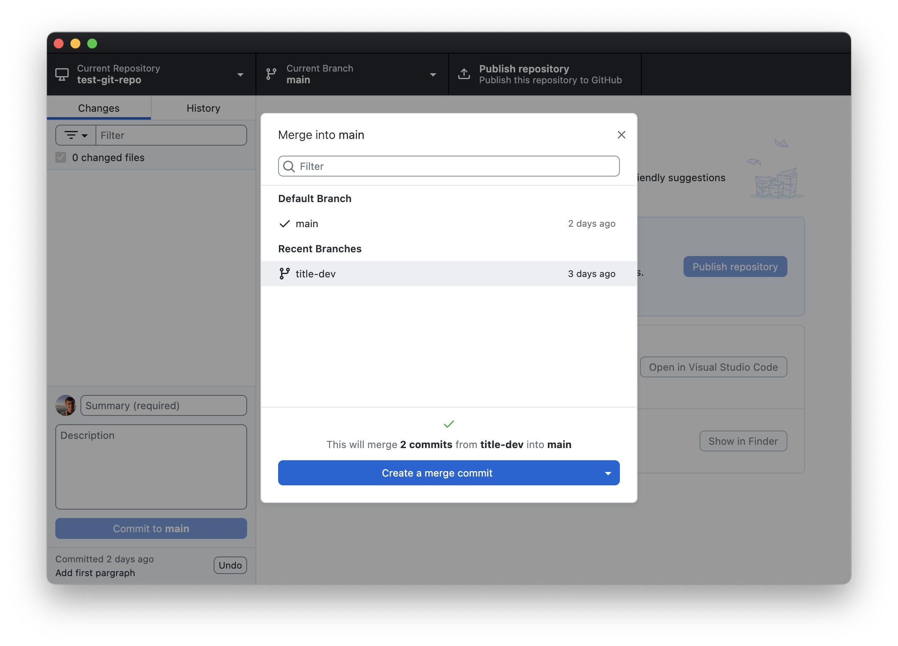

   #### Command line

   ```bash
   git merge title-dev
   ```

   This opens your text editor with the commit message `Merge branch 'title-dev'`. Don't change it, just save and exit to finish the merge:

   ```txt
   Merge made by the 'ort' strategy.
    title.txt | 5 +++++
    1 file changed, 5 insertions(+)
    create mode 100644 title.txt
   ```

   Notice how we have a summary of the changes that tells us that `title.txt` got five new lines.
   :::

1. Congratulations! You've made your first merge on to main. To see what happened, let's look at the history on the main branch:

   ::: {.panel-tabset}
   #### GitHub Desktop

   Click on the History tab:

   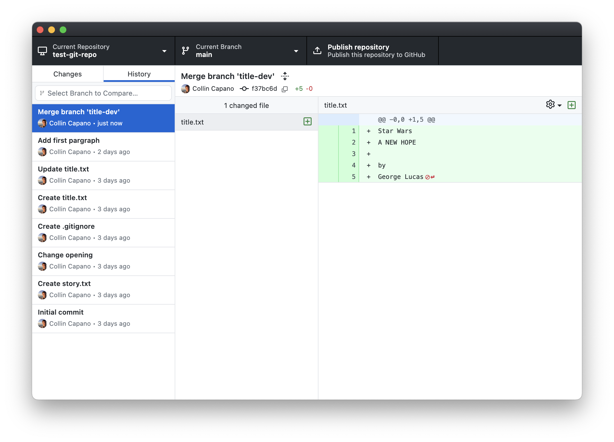

   #### Command line

   ```bash
   git log --oneline
   ```

   ```txt
   5a21f4b (HEAD -> main) Merge branch 'title-dev'
   1b45d74 (title-dev) Update title.txt
   c1d82b6 (main-bkup) Add first paragraph
   0517538 Create title.txt
   40d5b63 Create .gitignore
   b81e803 Change opening
   17b2095 Create story.txt
   ```
   :::

   The commits you made on `title-dev` are now in `main`, along with a final "Merge" commit at the end. This final "merge" commit is to indicate that some of the commits in the history came from another branch (and what the name of the branch was).

   `title.txt` is now in your directory when you're on `main`. If you switch between `main` and `title-dev`, `title.txt` remains in both. Note that the history on `title-dev` is unaffected by the merge: merging only changes the branch you merged *into*, not the branch you merged *from*.

::: {.callout-note title="Graph version"}
```{=html}
<pre class="mermaid backup-on-top">
%%{init: {"gitGraph": {"rotateCommitLabel": false, "mainBranchOrder": 1}}}%%
gitGraph
   commit id: "Initial commit"
   commit id: "Create story.txt"
   commit id: "Change opening"
   commit id: "Create .gitignore"
   branch title-dev order: 2
   commit id: "Create title.txt"
   checkout main
   commit id: "Add first paragraph"
   checkout title-dev
   commit id: "Update title.txt"
   checkout main
   branch main-bkup order: 0
   checkout main
   merge title-dev id: "Merge branch\n'title-dev'"
</pre>
```
:::

### Squash and merge: the cleaner history

Instead of creating a merge commit, we could have done a **squash and merge**. Let's see what would have happened by doing a squash and merge on to `main-bkup`.

1. Switch to the `main-bkup` branch.

   ::: {.panel-tabset}
   #### GitHub Desktop

   Click the "Current Branch" drop-down menu, and select `main-bkup`.

   #### Command line

   ```bash
   git checkout main-bkup
   ```

   ```txt
   Switched to branch 'main-bkup'
   ```
   :::

1. Squash and merge `title-dev` into `main-bkup`:

   ::: {.panel-tabset}
   #### GitHub Desktop

   When we were preparing to merge `title-dev`, you may have noticed there was a drop-down button next to the "Create a merge commit" button:

   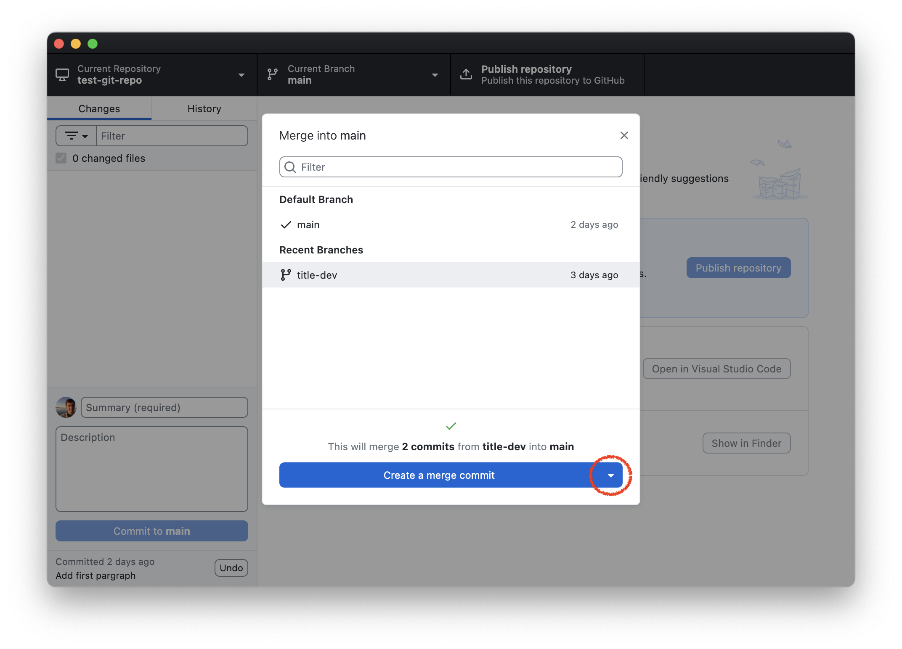

   If you had clicked that, you are presented with three options -- merge, squash and merge, and rebase:

   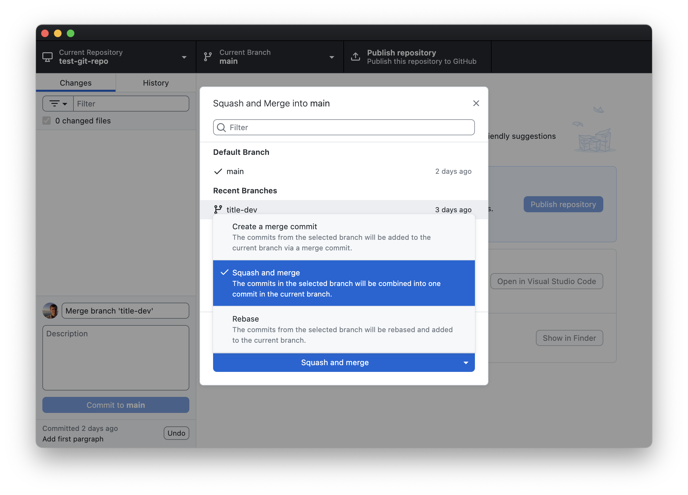

   a. Click "Current branch" again, and select "Choose a branch to merge into main-bkup". Select "title-dev", then click the drop down arrow next to the "Create a merge commit button".

   a. Select "Squash and merge". This will change the blue button to read "Squash and merge". Click that to do the squash and merge.

   #### Command line

   ```bash
   git merge --squash title-dev
   ```

   ```txt
   Squash commit -- not updating HEAD
   Automatic merge went well; stopped before committing as requested
   ```

   Unlike a regular merge, `--squash` stages the changes from `title-dev` but doesn't commit them. Commit them with:

   ```bash
   git commit
   ```

   This opens your text editor with a message listing the squashed commits. Save and exit (no need to update the message):

   ```txt
   [main-bkup 61857c0] Squashed commit of the following:
    1 file changed, 5 insertions(+)
    create mode 100644 title.txt
   ```
   :::

1. Look at the history on `main-bkup`:

   ::: {.panel-tabset}
   #### GitHub Desktop

   Click the History tab:

   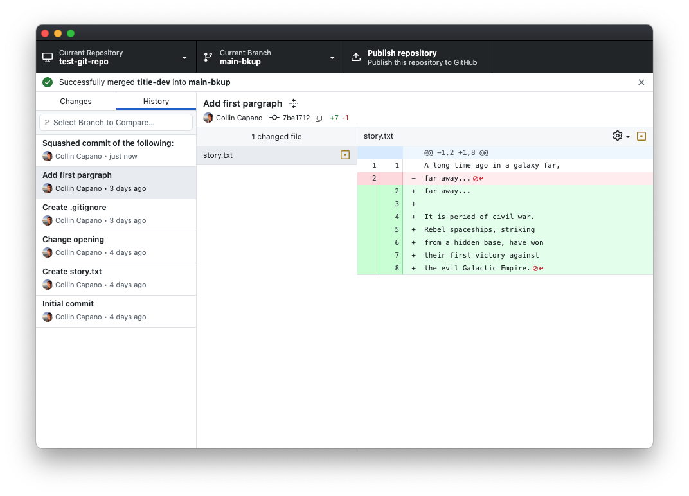

   #### Command line

   ```bash
   git log --oneline
   ```

   ```txt
   61857c0 Squashed commit of the following:
   c1d82b6 Add first paragraph
   40d5b63 Create .gitignore
   b81e803 Change opening
   17b2095 Create story.txt
   ```
   :::

The two commits that were done on `title-dev`, as well as the final merge commit, have all been "squashed" into a single large commit, which is placed at the end of the history on `main-bkup`. In graphical form, the history on `main-bkup` now looks like this:

::: {.callout-note title="Graph version"}
```{=html}
<pre class="mermaid backup-on-top">
%%{init: {"gitGraph": {"rotateCommitLabel": false, "mainBranchName": "main-bkup"}}}%%
gitGraph
   commit id: "Initial commit"
   commit id: "Create story.txt"
   commit id: "Change opening"
   commit id: "Create .gitignore"
   commit id: "Add first paragraph"
   commit id: "Squashed commit"
</pre>
```
:::

The contents of `main-bkup` are exactly the same as `main`, just the history is different. (You can verify this by switching between `main` and `main-bkup`.)

#### To merge, or to squash and merge?

This is one of the existing debates among Git users, and ultimately it is mostly a matter of preference regarding the commit history on the `main` branch:

- if we do not squash (as we did first), then all commits from our branch (potentially hundreds of commits) will also appear in the history of `main`;
- if we squash, all the commits from our branch will be condensed into a single commit, and only this commit will appear in the history of `main`.

The former can make it easier to find when a bug was introduced because we still have all these small commits so it can be easier to see which one contains the bug. The downside is that the author must be careful that all commits in the merged branch have a good name and description, otherwise it can make the commit history very hard to parse.

This choice also depends on whether multiple people contributed to the branch. With the "merge only" approach, each person's contribution is attributed in the history, and we can see who changed what with `git blame`. With the "squash and merge" approach, we can see from the commit message that multiple people contributed, but we cannot see who did what exactly (unless we go back to exploring the development branch, which can be tedious).

Personally, I use "squash and merge" most of the time to keep the history on `main` clean and straightforward (this is particularly nice on GitHub when using pull requests, as it will refer to the PR in the commit message; we will see this in exercise 3). 

### Updating a branch

Let's go back to our earlier situation for a moment, before merging:

```{=html}
<pre class="mermaid">
%%{init: {"gitGraph": {"rotateCommitLabel": false}}}%%   
gitGraph
   commit id: "Initial commit"
   commit id: "Create story.txt"
   commit id: "Change opening"
   commit id: "Create .gitignore"
   branch title-dev
   commit id: "Create title.txt"
   checkout main
   commit id: "Add first paragraph"
   checkout title-dev
   commit id: "Update title.txt"
</pre>
```

Note that when we decided to merge, our branch `title-dev` was out-of-sync with `main` since the commit `Add first paragraph` only exists on `main`. When we decided to merge `title-dev` into `main`, GitHub Desktop implicitly updated `title-dev` first:

[**TODO**: check whether this is actually the case]

```{=html}
<pre class="mermaid">
%%{init: {"gitGraph": {"rotateCommitLabel": false}}}%%   
gitGraph
   commit id: "Initial commit"
   commit id: "Create story.txt"
   commit id: "Change opening"
   commit id: "Create .gitignore"
   branch title-dev
   commit id: "Create title.txt"
   checkout main
   commit id: "Add first paragraph"
   checkout title-dev
   commit id: "Update title.txt"
   merge main id: "Merge 'main'"
   checkout main
   merge title-dev id: "Merge branch\n'title-dev'"
</pre>
```

In other words, it automatically updated our `title-dev` branch to the latest version of `main`, and did that using the "merging" approach.

Another way to do this is called **rebasing**. Rebasing is an operation where we change the base of our branch, so that the base no longer is the commit `Create .gitignore` but instead is `Add first paragraph`:

```{=html}
<pre class="mermaid">
%%{init: {"gitGraph": {"rotateCommitLabel": false}}}%%
gitGraph
   commit id: "Initial commit"
   commit id: "Create story.txt"
   commit id: "Change opening"
   commit id: "Create .gitignore"
   commit id: "Add first paragraph"
   branch title-dev
   commit id: "Create title.txt"
   commit id: "Update title.txt"
   checkout title-dev
</pre>
```

After rebasing, it *looks like* we had originally created the branch from the commit `Add first paragraph` right from the start, and we can merge our branch into `main` once it is ready:

```{=html}
<pre class="mermaid">
%%{init: {"gitGraph": {"rotateCommitLabel": false}}}%%
gitGraph
   commit id: "Initial commit"
   commit id: "Create story.txt"
   commit id: "Change opening"
   commit id: "Create .gitignore"
   commit id: "Add first paragraph"
   branch title-dev
   commit id: "Create title.txt"
   commit id: "Update title.txt"
   checkout title-dev
   checkout main
   merge title-dev id: "Merge branch\n'title-dev'"
</pre>
```

Should we choose merging or rebasing? This is another one of the few debates among git users, but generally it is not worth fighting about this. Both have pros and cons, starting with the ease of use. Merging is in general easier to manage when there are conflicts to resolve (see section 4 below), e.g. if the commit from `main` that we want to integrate in our branch modifies some files that our branch also modifies.

### Deleting branches

Now that you've merged your `title-dev` branch and are back on the `main` branch, you can delete it to save space. You can also delete `main-bkup` now if you like.

::: {.panel-tabset}
#### GitHub Desktop

To do that, click Current Branch, then right-click `title-dev`. This will yield a drop-down menu. Select "Delete branch":

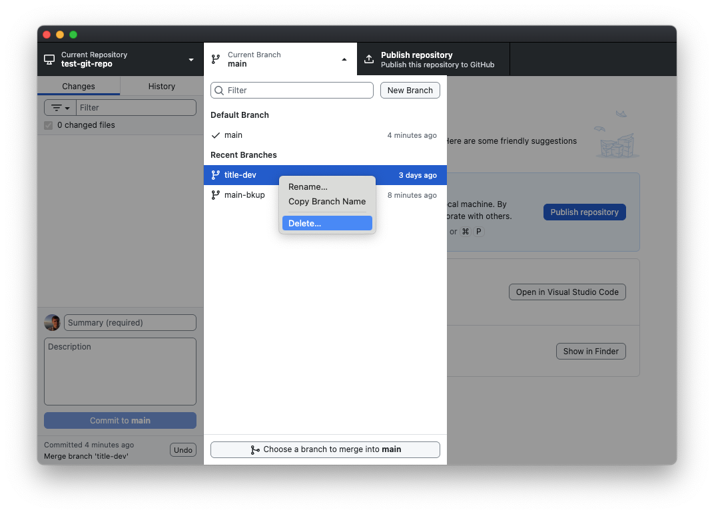

You will be prompted with a warning. Click the "Delete" button. The `title-dev` branch will be gone!

#### Command line

```bash
git checkout main
git branch -d title-dev
git branch -D main-bkup
```

```txt
Switched to branch 'main'
Deleted branch title-dev (was 1b45d74).
Deleted branch main-bkup (was 61857c0).
```

`-d` refuses to delete a branch whose commits aren't in the current branch, so that you don't lose them. `main-bkup` contains the squashed commit, which isn't on `main`, so it needs `-D` to force the deletion.
:::

## Challenge Questions: Editing the same file on different branches

In the above example we only made changes to different files on our two branches: on `main` we only edited `story.txt`, while on `title-dev` we only edited `title.txt`. However, there is nothing stopping us from editing the *same* file concurrently on two different branches. The following questions will illustrate how that works.

::: {.callout-caution appearance="simple" icon="false" title="Question 1: Setup"}
Create a file called `list.txt` that initially contains the following three lines:

```txt
alpha
bravo
charlie
```

Now use the what you learned above to do the following:

1. Add and commit `list.txt` to `main`.

2. Create a branch called `dev1`.

3. On `dev1` change the first line of `list.txt` to `delta` (i.e., replace `alpha`) then commit the change. Make the commit summary mesage be "add delta to list" when you do.

4. Go back to `main` and change the third line to `foxtrot` (i.e., replace `charlie`), then commit it.

::::: {.callout-caution collapse="true" appearance="simple" icon="false" title="Solution"}
:::::: {.panel-tabset}
#### GitHub Desktop

1. Once you create `list.txt` (use your text editor to do this), you should see it appear in the Changes tab in GitHub Desktop. Make sure you're on `main` (the Current Branch should say `main`; if not, click Current Branch -> main). Then:

   a. Click the check mark next to `list.txt`.
   b. Optionally add a summary, or just use the default "Create list.txt".
   c. Click the "Commit 1 file to main".

2. Do the following:

   a. Click Current Branch -> New Branch.
   b. Type `dev1` in the Name field.
   c. Click Create Branch.

3. Use your text editor to open `list.txt` and change the first line to `delta`. As soon as you save the file, you should the new line appear in the Changes tab on GitHub Desktop. Click the check mark next to `list.txt`, then type "add delta to list" in the summary field (this will replace the default "Update list.txt"), then click "Commit 1 file to dev1".

4. Do the following:

   a. If list.txt is open in your text editor, close it. Then click "Current branch" -> main to switch back to main.
   b. Open list.txt with your text editor and change third line to `foxtrot`, then save and exit.
   c. list.txt should appear in the Changes tab. Click the check mark next to it.
   d. Add "add foxtrot to list", then click "Commit 1 file to main".

#### Command line

Create `list.txt` with your text editor, then:

```bash
git checkout main
git add list.txt
git commit -m "Create list.txt"
git checkout -b dev1
# change the first line of list.txt to delta, then:
git commit -am "add delta to list"
git checkout main
# change the third line of list.txt to foxtrot, then:
git commit -am "add foxtrot to list"
```

`git commit -a` stages the changes of all tracked files before committing.
::::::
:::::

When you are done, `list.txt` should look like the following on `main`:

```txt
alpha
bravo
foxtrot
```

while on `dev1` it should look like:

```txt
delta
bravo
charlie
```
:::

::: {.callout-caution appearance="simple" icon="false" title="Question 2: Editing different lines"}
Now suppose you merge `dev1` into `main`. What happens to `list.txt`?

**A.** `main` takes precedence since it's the branch being merged into; `list.txt` will look like:

```txt
alpha
bravo
foxtrot
```

**B.** `dev1` takes precedence since it's the branch being merged; `list.txt` will look like:

```txt
delta
bravo
charlie
```

**C.** The changes from both are adopted; `list.txt` will look like:

```txt
delta
bravo
foxtrot
```

**D.** An error is raised because the same file was modified.

*If you're not sure, try it yourself and see what happens!*

::::: {.callout-caution collapse="true" appearance="simple" icon="false" title="Solution"}
The answer is **C**. Since different lines have been modified, `git` is able to merge the changes together without issue. To do it yourself:

:::::: {.panel-tabset}
#### GitHub Desktop

a. Click Current Branch -> main to switch to main.
b. Click Current Branch -> "Choose a branch to merge into main"
c. Select dev1 then click "Create a merge commit".

#### Command line

```bash
git checkout main
git merge dev1
```
::::::
:::::
:::

::: {.callout-caution appearance="simple" icon="false" title="Question 3: Editing the same lines"}
After merging `dev1` on to `main`, suppose you create another branch called `dev2`. On `dev2` you change the second line of `list.txt` to be `echo` while on `main` you change the second line to `easy`; i.e. on `main` `list.txt` looks like:

```txt
delta
easy
foxtrot
```

On `dev2` `list.txt` looks like:

```txt
delta
echo
foxtrot
```

**What happens if you merge `dev2` into `main` in this case?**

**A.** `main` takes precedence since it's the branch being merged into; `list.txt` will look like:

```txt
delta
easy
foxtrot
```

**B.** `dev2` takes precedence since it's the branch being merged; `list.txt` will look like:

```txt
delta
echo
foxtrot
```

**C.** The changes from both branches are adopted; `list.txt` will look like:

```txt
delta
easy
echo
foxtrot
```

**D.** An error is raised because the same line is modified.

::::: {.callout-caution collapse="true" appearance="simple" icon="false" title="Solution"}
The answer is **D**, an error is raised. Since the same line has been modified in the same file, `git` cannot tell how to reconcile the differences. This is known as a *merge conflict*. In this case, `git` will leave it up to the user to reconcile the differences. How to do that is discussed in the next section.
:::::
:::

## IV. Resolving merge conflicts

As illustrated in the Challenge Questions, if the same lines in the same file are modified on two different branches, `git` will not know how to merge the changes. This is called a **merge conflict**. In this case, `git` will ask you to reconcile the differences. To illustrate, let's try merging `dev2` into `main` after making the changes to `list.txt` discussed in Question 3 above:

1. If you have not done so, try to merge `dev2` into `main` after making the changes to the second line of `list.txt` discussed in Question 3:

   ::: {.panel-tabset}
   #### GitHub Desktop

   a. Switch to `main`: Click Current Branch -> main.
   b. Click Current Branch -> Choose a branch to merge into "main".
   c. Select dev2, then  click "Create a merge commit" (note that a message pops up above the button that says there be 1 conflicted file).

   #### Command line

   ```bash
   git checkout main
   git merge dev2
   ```
   :::

1. The merge fails, and Git tells you what files are conflicted (in this case `list.txt`):

   ::: {.panel-tabset}
   #### GitHub Desktop

   You will get the Resolve conflicts box:

   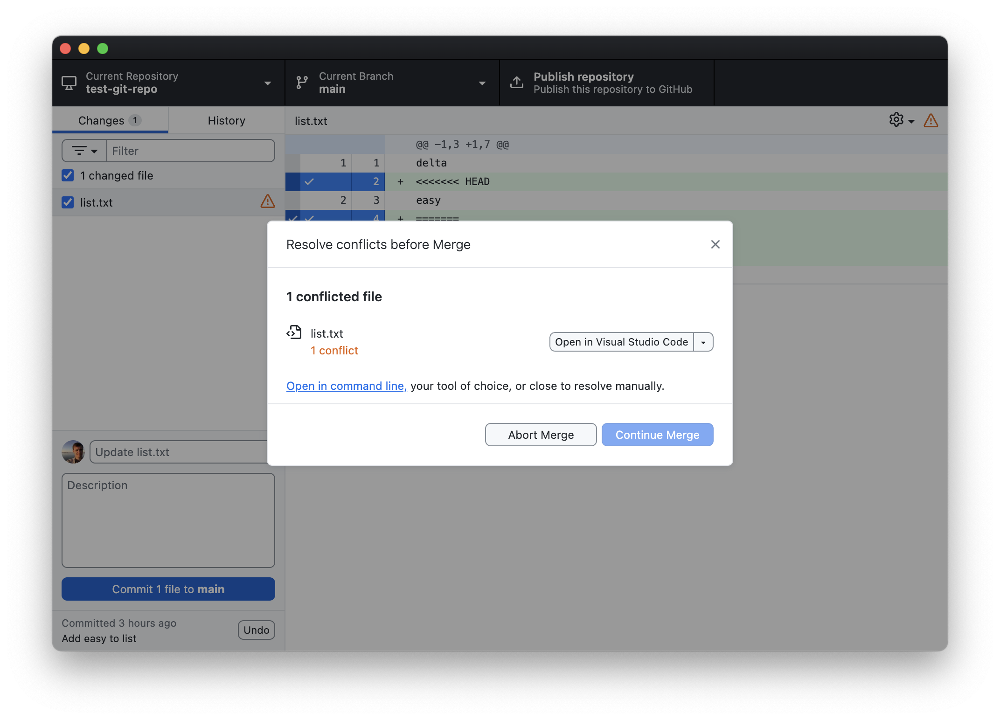

   #### Command line

   You will get:

   ```txt
   Auto-merging list.txt
   CONFLICT (content): Merge conflict in list.txt
   Automatic merge failed; fix conflicts and then commit the result.
   ```

   `git status` also lists the conflicted files under `Unmerged paths`:

   ```txt
   On branch main
   You have unmerged paths.
     (fix conflicts and run "git commit")
     (use "git merge --abort" to abort the merge)

   Unmerged paths:
     (use "git add <file>..." to mark resolution)
           both modified:   list.txt

   no changes added to commit (use "git add" and/or "git commit -a")
   ```
   :::

   To fix this, we need to manually resolve the conflict. There are several options to deal with this, such as using a code editor like VS Code. Here, though, we'll use our simple text editor to resolve the issue.

1. Open list.txt with your text editor. You should see the following:

   ```txt
   delta
   <<<<<<< HEAD
   easy
   =======
   echo
   >>>>>>> dev2
   foxtrot
   ```

   `git` has added the conflicting lines from both branches to the file, along with information about the two branches. The line as it appears on `main` is prefaced with `<<<<<<< HEAD`. This indicates that the following line(s) is (are) how it appears on the branch being merged into. The line(s) is (are) followed by a `=======`.

   After the `=======` the line(s) as it/they appear(s) on the branch being merged are shown. These are followed by `>>>>>>> BRANCH_NAME` (here, `BRANCH_NAME` is `dev2`).

1. We are free to edit the file anyway we like to resolve the conflict. You should remove the `<<<<`, `====`, and `>>>>` lines that `git` has added, along with the edit you want to make to resolve the conflict.

   In this case, let's keep the edit as it appears on `dev2`, and remove the edit on `main`. Delete the appropriate lines so that the file looks like:

   ```txt
   delta
   echo
   foxtrot
   ```

   Then save and exit the file.

1. Complete the merge:

   ::: {.panel-tabset}
   #### GitHub Desktop

   As soon as you save the changes to `list.txt`, the merge conflict window in GitHub Desktop will change to show that all conflicts have been resolved:

   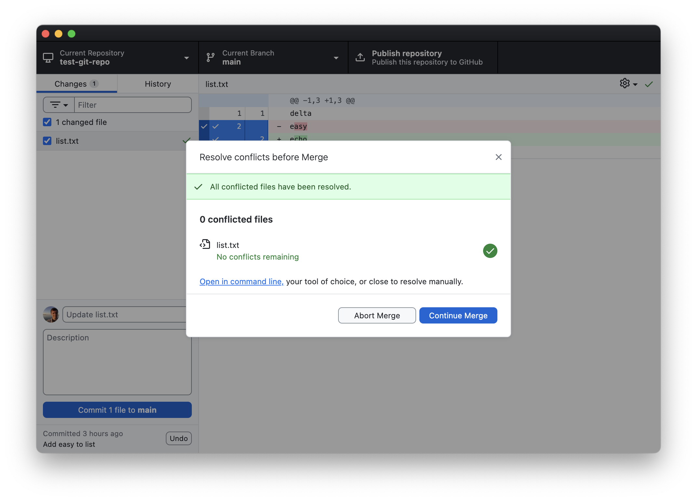

   Click "Continue Merge".

   #### Command line

   Stage the file and commit *without* the `-m`:

   ```bash
   git add list.txt
   git commit
   ```

   This opens your text editor with the commit message set to `Merge branch 'dev2'`. Save and exit:

   ```txt
   [main 1c5dcc2] Merge branch 'dev2'
   ```
   :::

1. The merge conflict is resolved! If you look at the history, you will see all the commits in it, as if you had merged without any issue.

Merge conflicts happen, but can be fixed fairly easy. If there were multiple areas in a file that caused a conflict, the conflicting areas would all be surrounded by the same `<<<<<<< `/`=======`/`>>>>>>>` lines that we saw above. You'll want to search through the file for those to make sure you got all the conflicts. If multiple files had conflicts, `git` will make you resolve all of them before allowing the merge to complete.

## Summary

In this exercise, we learnt three key concepts to use Git (repositories, commits, and branches), and we saw how to use GitHub Desktop or the command line to initialise a Git repository and explore various Git commands. 

In the [next exercise](exercise2.qmd), we will see how to store a Git repository online and how to interact with it. Finally, in the [third exercise](exercise3.qmd), we will see how to collaborate on other people's repositories.

```{=html}
<!-- Must come after the <pre>: the loop only mounts elements already in the DOM -->
<script src="https://cdn.jsdelivr.net/npm/pele@1/dist/pele.global.js"></script>
<style>
  /* Room for the labels moved above the line, which fall outside the SVG's viewBox */
  /* !important beats Quarto's `.callout-body > :first-child` padding reset inside callouts */
  pre.mermaid { padding-top: 3em !important; }
  pre.mermaid > svg { overflow: visible; }
  /* pele colours lanes by position, so putting main-bkup on top would recolour main and
     title-dev: restore pele's defaults (main blue, title-dev orange) and make main-bkup green */
  pre.mermaid.backup-on-top {
    --pele-series-1: #54a24b;
    --pele-series-2: #4c78a8;
    --pele-series-3: #f58518;
  }
</style>
<script>
  // pele always puts commit labels below the line: mirror every other one above it
  const alternate = (el) => el.querySelectorAll('.pele-commit-label').forEach((label, i) => {
    if (i % 2 === 0) return;
    const dot = label.parentElement.querySelector('circle, rect').getBBox();
    const box = label.getBBox();
    label.setAttribute('transform', `translate(0 ${2 * (dot.y + dot.height / 2) - 2 * (box.y + box.height / 2)})`);
  });
  // Commit that each never-committed branch (e.g. a backup) was created from
  const forks = (src) => {
    const tip = {}, from = {};
    let cur = 'main';
    for (const line of src.split('\n')) {
      const [cmd, name] = line.trim().split(/\s+/);
      if (cmd === 'commit' || cmd === 'merge') { tip[cur] = line.match(/id: "(.*?)"/)?.[1]; delete from[cur]; }
      if (cmd === 'branch') from[name] = tip[name] = tip[cur];
      if (cmd === 'branch' || cmd === 'checkout') cur = name;
    }
    return from;
  };
  // pele only draws a dashed lane for branches without commits: add a solid line forking off
  // their source commit, so they read as a copy of it
  const drawForks = (el, from) => el.querySelectorAll('.pele-branch').forEach((branch) => {
    const dot = el.querySelector(`.pele-commit[data-id="${CSS.escape(from[branch.dataset.id] ?? '')}"] :is(circle, rect)`)?.getBBox();
    const edge = el.querySelector('.pele-edge')?.cloneNode();
    if (!dot || !edge) return;
    const lane = branch.querySelector('.pele-lane');
    const [, y, end] = lane.getAttribute('d').match(/-?[\d.]+/g);
    const [x, cy] = [dot.x + dot.width / 2, dot.y + dot.height / 2];
    // Same S-curve (36px wide) as pele's own branch edges
    edge.setAttribute('d', `M${x},${cy}C${x + 18},${cy} ${x + 18},${y} ${x + 36},${y}H${end}`);
    edge.setAttribute('stroke', lane.getAttribute('stroke'));
    edge.setAttribute('fill', 'none');
    branch.append(edge);
  });
  // onRender because pele redraws the SVG on resize
  for (const el of document.querySelectorAll('pre.mermaid')) {
    const from = forks(el.textContent);
    pele.mount(el, el.textContent, { onRender: () => { alternate(el); drawForks(el, from); } });
  }
</script>
```