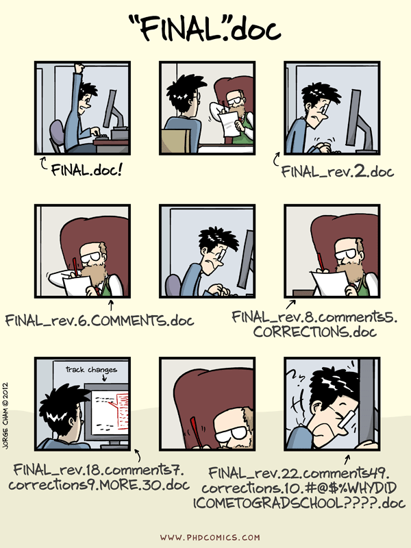
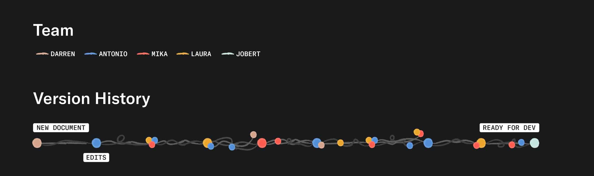

## Objectives

- Learn how to use git with GitHub Desktop
- Learn how to do version control with `git`
- Understand the differences between `git` and GitHub
- Use GitHub to collaborate with others on a project

## Motivation

### Keep track of changes

:::: {.columns}

::: {.column width="55%"}
Imagine that you are working on a project. This project could be an academic paper, a Master's thesis, a small blog post, an R package, any kind of project where you write text over several working sessions.

You start making progress, you are pretty happy with the way it's going. Suddenly you notice that your introduction (or your code to analyse data, or anything else) could be improved, although you don't know exactly how. 

You make changes but you are not really sure if this is going anywhere, so you'd like to keep a version of your past work, *just in case*. You can do that either by creating a copy of your file or by commenting out parts of the original file.

In the end, you keep your new changes but also the previous version, *just in case*.
:::
::: {.column width="5%"}
:::
::: {.column width="40%"}

:::

::::

Later, you send your report to your supervisor or project manager, who tells you to explore various parts of your project more in depth. You start making changes, but you also had some experience where this person told you to do the opposite a few weeks later, so you create new copies and comment out more text, *just in case*.

As time goes, the folder containing your project starts looking like: `analysis_1.R`, `analysis_1bis.R`, `analysis_final.R`, `report_v1.docx`, `report_v2.docx`, `report_final.docx`, `report_final_final.docx`, etc.

Ideally, we would like to have only two files (`analysis.R` and `report.docx`), while keeping access to previous versions of these files. And we would also like to see precisely what changed between these versions. In other words, we want some kind of **version control**, and this is exactly what Git and GitHub were built to do. They are essential tools to be familiar with, and while they were originally created for software projects, they can be used with any kind of text files. 

On top of keeping a history of all changes happening across all tracked files, they greatly facilitate collaboration. 

### Collaborate more efficiently

You might think: "all of this is very nice, but my collaborators and I already use Google Docs and/or Dropbox, so why bother?".

This is a legitimate question! Google Docs and other tools to do collaborative work seem to address a similar need as Git and GitHub do, and their ubiquity means that these tools are sometimes more appropriate, depending on the context.

Nevertheless, besides the fact that these tools are not integrated in code editors (such as RStudio, Positron), meaning that we would need to copy and paste code across files, they also come with their own pain points: 

- Someone edits or deletes the paragraph you were working on at the same time.
- You can see *what* changed, but not *why* this change happened.
- Restoring an older version of a document also undoes everyone else's more recent work.
- Trying to do massive changes requires making file copies so that you don't affect everyone else's work, so you still end up with files like `manuscript_v2_final_FINAL.docx` or `analysis_old_DO_NOT_USE.R`.



These pain points allow us to distinguish **version history** (what Google Docs does) and **version control** (what Git does):

- version history: everyone works on the same copy of the document at the same time, and *the software* decides when to save. If two people edit the same sentence at once, one of them wins. We can only go back to whatever moment the software happened to save, and everything that changed after that moment is rolled back with it.

- version control: *we* decide when to save a snapshot of our work, and each snapshot records who made it and a message describing what was changed. Every piece of work can be done in parallel, and no matter whether it is eventually integrated in the project or abandoned, it will always be easy to recover. If two people modify the same thing, *people* get to decide which one should be preferred.

Git and GitHub give much more control to users, meaning that they also take more effort to learn than Google Docs. In this module, we will gradually see how to use Git and GitHub on our own projects, and then we will see how to efficiently collaborate.

## Exercises

This module is divided in three parts:

- [Part 1](exercise1.qmd): Practice with GitHub Desktop on a local repository
- [Part 2](exercise2.qmd): Interacting with remote repositories on GitHub
- [Part 3](exercise3.qmd): Collaborating in GitHub using the Fork and Pull Model

## Prerequisites

The following should be done *before* doing the exercises above. 

Git and GitHub can be used via GitHub Desktop (a graphical interface) or via the command-line interface (CLI). This tutorial shows how to use both.

::: {.panel-tabset}
### GitHub Desktop

Install [GitHub Desktop](https://github.com/apps/desktop).

::: {.callout-note title="See detailed installation instructions" collapse="true"}
To install:

1. Go to <https://github.com/apps/desktop>{.external target="_blank"}.
2. Click the "Download now" button.
3. What you do next depends on your operating system:

- If you're on a Mac:
  a. Click "Download for Apple silicon" or "Download for Intel chip" depending on your processor. If you're not sure what processor you have, click the apple button in your Menu bar then "About This Mac". Look at the "Chip" entry in the window that pops up. If it says, "Apple M..." you have Apple silicon. If it says, "Intel ..." you have an Intel chip.
  b. Clicking one of the download buttons will download a .zip file that starts with "GitHubDesktop". Once it's finished downloading, open it. The file will unzip and open a Finder window.
  c. Move the GitHub Desktop icon into your Applications folder in Finder.
  d. Open GitHub Desktop as you would any other application (e.g., by going to Launchpad and clicking on the GitHub Desktop icon).
  e. The first time you open GitHub Desktop you will be prompted with a warning, "'GitHub Desktop' is an app downloaded from the internet. Are you sure you want to open it?" Click "Open".
- If you're on a Windows machine:
  a. Click "Download for Windows (64 bit)". This will download a file called "GitHubDesktopSetup-x64.exe".
  b. Once the file downloads, it will automatically install and open GitHub Desktop.
:::

The first time you open GitHub Desktop you will need to sign into GitHub.

1. Click "Sign in to GitHub.com". If you do not have an account yet, click "Create your free account".
2. Follow the on-screen instructions to sign in.
3. After you sign in, GitHub Desktop will ask you to "Configure Git". We recommend you select the option "Use my GitHub account name and email address". Click "Finish".

You will next be prompted with a "Let's get started!" screen that will ask you to add a repository to GitHub Desktop. **Stop here** and go to  [Part 1](exercise1.qmd).

### Command line

#### Git configuration

Before doing the exercises in this session, you'll need to tell `git` what your name and email are, so that it creates commits with the appropriate author information. To do that, open a terminal and run the following (it doesn't matter which directory you run these from), but replacing `YOUR NAME` with your name and `YOUR_EMAIL_ADDRESS` with your email address:

```bash
git config --global user.name "YOUR NAME"
git config --global user.email "YOUR_EMAIL_ADDRESS"
```

#### GitHub authentication

In exercises 2 and 3 you will be using GitHub to "push" and "pull" commits between your local computer and GitHub's servers over HTTPS. Pushing requires `git` to authenticate you, but GitHub doesn't accept your account password for this.

- **On Windows**, Git for Windows comes with the Git Credential Manager: the first time you push, a browser window opens to log in to GitHub, and your credentials are stored for next times. There is nothing to set up.

- **On Mac or Linux**, the simplest way is to install the [GitHub CLI](https://cli.github.com/) and run:

  ```bash
  gh auth login
  ```

  Select "GitHub.com", then "HTTPS", answer "Yes" when asked to authenticate Git with your GitHub credentials, and log in with your web browser.
:::


## Acknowledgements

This module is heavily based on a [workshop](https://su-ospo.github.io/workshop-computing-intro-2025/03_github/){.external target="_blank"} developed by the [Syracuse University Open Source Program Office](https://opensource.syracuse.edu/){.external target="_blank"}.
