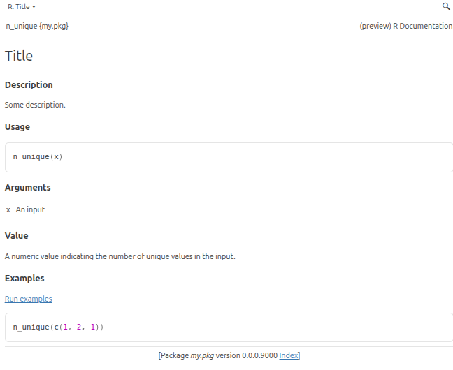

In this section, we will see how to create the basic structure of an R package.

## Structure of a package

At a minimum, a package **must have** two folders:

- `R`: contains all the `.R` files where we will write our functions

- `man`: short for "manual". This will contain all the documentation that is
  accessible with `?` in R (for example `?factor`)

While not mandatory, it is also recommended to have the following folders:

- `tests`: contains all the tests for your package

- `vignettes`: additional documentation that contains more extensive examples and
  tutorials for your package.

This section focuses on `R` and `man`, we will see how to populate these other folders in separate sections.

## Practical example

The easiest way to learn how to make a package is to actually make one.

Let's say that we have already two functions and that we use them in our work, but now we want to package them so that they are easier to share with coworkers. Our two functions are:

1. A function to compute the logarithm that returns `NULL` if the input is not
   numeric:

```{r}
#| eval: true
#| error: true
#| warning: true

safe_log <- function(x) {
  if (is.numeric(x)) {
    log(x)
  } else {
    warning("Can't compute the logarithm of a non-numeric input.")
    NULL
  }
}
log("a")
safe_log("a")
```

2. A function to count the number of unique elements in a vector:

```{r}
#| eval: true
#| error: true

n_unique <- function(x) {
  length(unique(x))
}
n_unique(1:10)
n_unique(c(1, 1, 2, 3, 4, 4))
```


### Create the package

Let's create a package called `my.pkg`. We can do this in various ways:

- we can use `usethis` in an R console:
  ```{r}
  usethis::create_package("<path>/my.pkg")
  ```

- with RStudio: File > New Project > New Directory > R Package > Name it, and choose its location

If we choose to do this with `usethis`, then we should see this:

```
✔ Creating my.pkg/.
✔ Setting active project to "/home/etienne/Desktop/Git/modules/my.pkg".
✔ Creating R/.
✔ Writing DESCRIPTION.
Package: my.pkg
Title: What the Package Does (One Line, Title Case)
Version: 0.0.0.9000
Authors@R (parsed):
    * First Last <first.last@example.com> [aut, cre]
Description: What the package does (one paragraph).
License: `use_mit_license()`, `use_gpl3_license()` or friends to
    pick a license
Config/roxygen2/version: 8.1.0
Encoding: UTF-8
Roxygen: list(markdown = TRUE)
✔ Writing NAMESPACE.
✔ Writing my.pkg.Rproj.
✔ Adding "^my\\.pkg\\.Rproj$" to .Rbuildignore.
✔ Adding ".Rproj.user" to .gitignore.
✔ Adding "^\\.Rproj\\.user$" to .Rbuildignore.
✔ Opening /home/etienne/Desktop/Git/modules/my.pkg/ in a new session.
✔ Setting active project to "<no active project>".
```

There is a lot of information to unpack here! We can see that this command created a folder `my.pkg`, an `R` folder inside it, and then it created multiple files: `DESCRIPTION` and `NAMESPACE`.

Printing the structure of the `my.pkg` folder may be useful here:

```r
my.pkg
├── DESCRIPTION
├── NAMESPACE
├── R
└── my.pkg.Rproj
```

::: {.callout-tip title="How to print a tree structure as above?" collapse="true"}
If you have the package `fs` installed, you can use `fs::dir_tree()` with the path you want.

For example, if `my.pkg` is your working directory then you can simply call `fs::dir_tree()`, but if it is a subfolder then you need to call `fs::dir_tree("my.pkg")`.
:::

The `DESCRIPTION` file contains all the important information about our package:

- who built it?
- when?
- what is the goal of the package?
- what is the version of the package?
- what are its dependencies?

and a lot more information.

The `NAMESPACE` file contains all the information about the functions that are imported and exported by our package. **Imported functions** are provided by other packages, meaning that these packages are now our dependencies. **Exported functions** are what our package provides, i.e. the functions made available to users of our packages after they call `library(my.pkg)` or when they use `my.pkg::`.

The `R` folder is where we are going to store our functions.

### Add our functions

Let's create two files in the `R` folder: `n_unique.R` and `safe_log.R`. We don't *need* to create one file per function, we could just bundle everything in a single file. However, it is generally good practice to keep those separated, especially when we start creating more exported functions. We can now move the functions we created to each of these files:

```{.r filename="R/n_unique.R"}
n_unique <- function(x) {
  length(unique(x))
}
```

```{.r filename="R/safe_log.R"}
safe_log <- function(x) {
  if (is.numeric(x)) {
    log(x)
  } else {
    warning("Can't compute the logarithm of a non-numeric input.")
    NULL
  }
}
```

Our package structure now is:

```
my.pkg
├── DESCRIPTION
├── NAMESPACE
├── R
│   ├── n_unique.R
│   └── safe_log.R
└── my.pkg.Rproj
```

When we create a standalone function in a non-package project, we need to evaluate it in the R console to then be able to run it. Doing this for all functions in an R package would be very tedious. Moreover, the order in which R files are evaluated may matter. Therefore, we can use `devtools::load_all()` whenever we want to load the package we are currently developing:

```r
> devtools::load_all()
ℹ Loading my.pkg
```

We are now be able to run our functions in the console! We have now populated one of the two mandatory folders (`R`), so let's move on to the documentation process, which will lead to the creation of the `man` folder.

## Document a function

The documentation of a function is done in the `.R` file: it will then automatically be converted to an `.Rd` file placed in the `man` folder. There is *no need* to create an `.Rd` file yourself!

Writing the documentation is similar to writing comments, but you need to use `#'` (with an apostrophe) instead of `#`.

```{.r filename="R/n_unique.R"}
#' Title
#'
#' @description
#' Some description.
#'
#' @param x An input
#'
#' @return A numeric value indicating the number of unique values in the input.
#' @export
#'
#' @examples
#' n_unique(c(1, 2, 1))

n_unique <- function(x) {
  length(unique(x))
}
```

Let's go through these changes:

- `description` contains the text that appears between the title and the "Usage" section in a function help page. Usually it contains a few sentences describing the general purpose of the function.
- `@param` is the description of the expected input (there can be several `@param` tags);
- `@return` is the description of what this function returns;
- `@export` indicates that this function is exported, i.e is available to users of this package;
- `@examples` gives some examples that show how the function works.

These are `roxygen2` tags, and there are many more that you can find here: https://roxygen2.r-lib.org/articles/rd.html.

Let's now run `devtools::document()` to create the `.Rd` file.

::: {.callout-note title="I have a 'Skipping NAMESPACE' message" collapse="true"}
Maybe `devtools::document()` will print the following message:

```
ℹ Updating my.pkg documentation
ℹ Loading my.pkg
✖ Skipping NAMESPACE
ℹ It already exists and was not generated by roxygen2.
```

In this case, delete `NAMESPACE` and run `devtools::document()` again.
:::

You should see the following message:

```
ℹ Updating my.pkg documentation
ℹ Loading my.pkg
Writing n_unique.Rd
```

You should then be able to access the documentation of our function with `?n_unique`.

::: {style="text-align: center;"}

:::

We have the minimal documentation but you can make it much bigger. Note that we can also use [Markdown syntax](https://roxygen2.r-lib.org/articles/rd-formatting.html) in the text.


::: {.callout-caution title="Exercise"}
Your turn! Improve the documentation:

1. write a longer description for `n_unique()`
1. create the documentation for `safe_log()`
1. add more explanations in the `@details` section of `safe_log()`

Don't forget to re-document so that your changes appear in `.Rd` files in `man`.
:::

The help page is one of the first things users will check to learn about your functions. Give details and *examples*!

We now have the most basic structure of a working R package. Let's build it!

## Build the package

