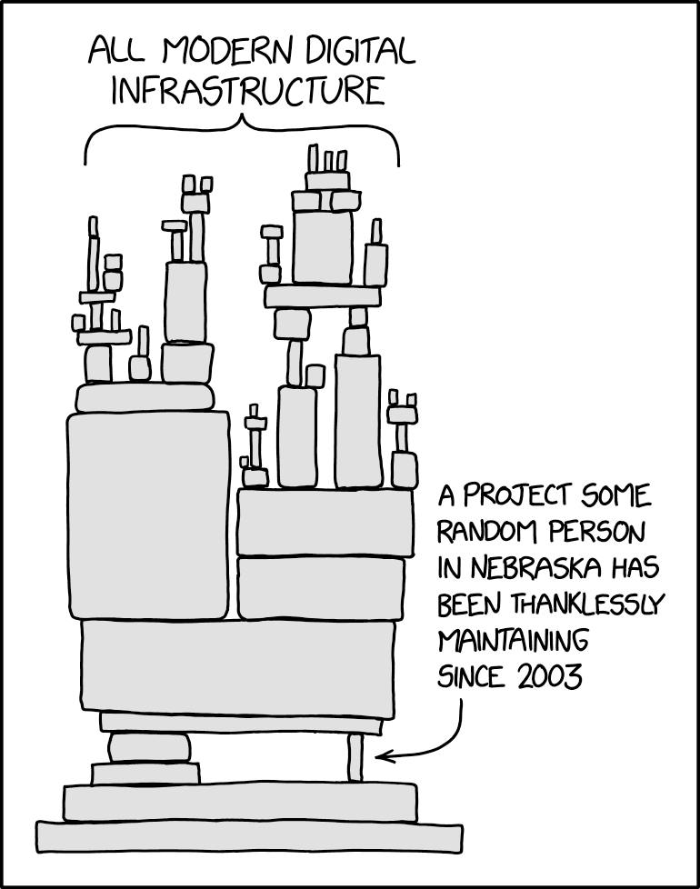

We now know the basics of a package: how to create one, document it, and test
it.

But creating a package is not only that. There are plenty of choices to make,
such as:

- how should I name my functions?

- what dependencies should my package have?

## Namespace

The `NAMESPACE` file contains the list of functions that your package exports.

When someone loads your package with `library(my.pkg)`, all exported functions will be imported in the environment.

In the (very likely) event where this person uses several packages, there can
be a **namespace conflict** if two packages (or more) provide two functions with the same name.

It is also possible that some of your functions have the same name as
functions included by default in R.

For example, `dplyr` overwrites several functions:

```r
library(dplyr)

## Attaching package: ‘dplyr’
##
## The following object are masked from ‘package:stats’:
##  
##  filter, lag
##
## The following objects are masked from ‘package:base’:
##   
##  intersect, setdiff, setequal, union
```

While the user has some means to fix such conflicts (e.g see the package
[`conflicted`](https://conflicted.r-lib.org/)), you should do your maximum
to avoid them.

In particular, be very careful that your functions don't have the same names
as other functions in popular packages (e.g `data.table`, `tidyverse`
packages, etc.).

**Advanced:** S3 methods.

Have you ever wondered how `summary()` worked with so many outputs? Or `print()`? Or `plot()`?

`summary()` is an *S3 method* that gets *dispatched* according to the class of
its input.

**EXPLAIN MORE ON S3 METHODS?**

## Dependencies

::: {style="text-align: center;"}

:::

When you develop your package, you can import other packages, either because
they provide essential features or simply because they make the development
easier.

However, these dependencies have a **cost**:

- they make your package more fragile: changes in these dependencies also affect your package;

- they force users to have these dependencies [IS IT REALLY A COST?]

Therefore, you have to find the right balance:

- dependencies are not a bad thing *per se*

- but they increase the maintenance burden and the risk of failure in the
  long run.

This might seem abstract, so let's take an example. Suppose that for one
reason or another, your package uses the function `select_vars()` from the
package `dplyr`.

This function was removed in `dplyr` v. 1.1.0.

This has implications for the user of your package:

- if their version of `dplyr` is < 1.1.0, it still works fine;

- if their version of `dplyr` is >= 1.1.0, then the function in your package
  that uses `select_vars()` will error.

Having dependencies forces you to stay aware of changes in these dependencies
and this increase the maintenance burden.

