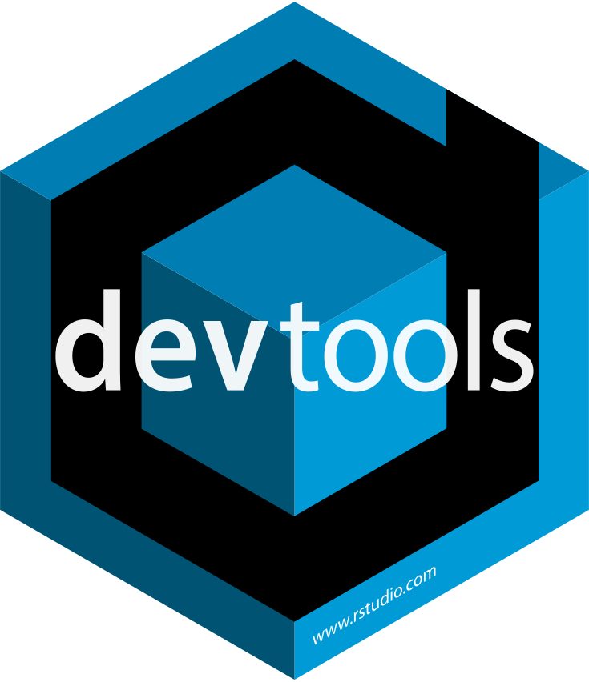
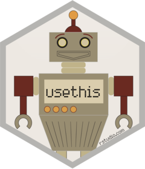

::: {.callout}
## Learning Objectives

After this module, you will:

- Be able to convert standalone R functions to an R package
- Know how to document, test, and share your package
- Know how to set up continuous integration workflows to regularly test your package
:::

An R package is a way to convert a collection of functions into a well-organised, documented, and ideally well-tested piece of software that other people can easily install and use. A lot of the work goes into the creation of functions (for which we have [a module](https://palaeoverse.org/modules/pr-preview/pr-3/training/modules-dev/writing_functions/index.html)!).

This module will show you the multiple steps of R package development, from having a single standalone function, to creating, documenting, testing, and sharing a package.

It is easy to expand on many of these aspects, and we will cover the most important ones, but entire books are written on package development (and on software development in general). Therefore, we will purposely skip or not explore in depth some aspects of package development. This module is inspired by the ["R Packages" book](https://r-pkgs.org/), and we recommend exploring this book more if you want to dig deeper on the topic on general, or on specific aspects only.

This module is divided in five parts:

1. [**Create a package**](create.qmd): how to create the minimal structure of an R package

1. [**Test a package**](test.qmd): how to build a test suite.

1. [**Develop a package**](develop.qmd): some good practices and considerations to keep in mind when developing an R package

1. [**Share a package**](share.qmd): how to make your package installable by anyone

1. [**Use continuous integration**](ci.qmd): how to use GitHub or other platforms to check your package on every change

Before we start, we recommend installing these three packages:

```r
install.packages(c("devtools", "testthat", "usethis"))
```

::: {.columns .center}
::::: {.column width="33%"}

:::::

::::: {.column width="33%"}

:::::

::::: {.column width="33%"}

:::::
:::
