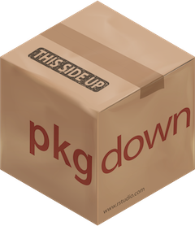

Having a package is cool but it's much less useful if you keep it for you^[Although it can be a fine practice.].

There are two main, non-exclusive ways to share your package to the world:

- put it on Github
- put it on CRAN

## Github

Git and Github are useful tools for code sharing, which means they're perfect to
share an R package.

This is *not* a Git tutorial, I'll "just" show how to connect Git and Github to
RStudio.

If this is already done, skip the next two slides.

1. Download and install [Git](https://git-scm.com/).

2. Connect Git and RStudio:

   - in RStudio: Tools > Global Options > Git/SVN > Git executable > Browse >
     Find your installation of Git

   - it should probably be similar to mine: "C:/Users/etienne/AppData/Local/Programs/Git/bin"

3. If necessary, create an account on [Github](github.com/).

4. In RStudio, run `usethis::use_git_config(user.name = "<YOUR NAME>", user.email = "<YOUR EMAIL>")` ^[Note that the email must be the same as the one used to create the Github account.]

5. Now you need a token that will be stored in RStudio so that Github knows that RStudio has the right to push code to your repositories. You can create one with `usethis::create_github_token()` (you can also change the expiration date).

6. Generate the token and store it in RStudio with `gitcreds::gitcreds_set()`.

7. Restart RStudio.

Doesn't work? More info at [Happy Git with R](https://happygitwithr.com).

## CRAN

::: {style="text-align: center; font-size: 2.3rem"}
CRAN
<br>
<br>
Comprehensive R Archive Network
<br>
<br>
Where packages are stored (around 20,000 packages currently).
:::

Put a package on CRAN:

- Pros:
  - More visibility
  - Package is tested before being uploaded
  - Package is tested with new versions of R or with new versions of its dependencies

- Cons:
  - Delay to fix a bug in your package can be short (2 weeks)

CRAN has strict rules in terms of formatting or testing, but that shouldn't worry you:

- there are some collaborative todo lists before submitting to CRAN, such as [this one](https://github.com/ThinkR-open/prepare-for-cran)

- there are a lot of packages to make your life easier ([urlchecker](https://cran.r-project.org/web/packages/urlchecker/index.html), [spelling](https://cran.r-project.org/web/packages/spelling/index.html), etc.)

## Website

We could stop here, but we can add something more: a website!

And no, it won't (or rather shouldn't) take long.

::: {.columns .center}
::::: {.column width="50%"}
We're going to use an amazing package to build a package website in a few minutes: `pkgdown`
:::::

::::: {.column width="50%"}

:::::
:::

```{r}
# if not already installed
install.packages("pkgdown")
```

### Local website

Before putting the website online, we can already create locally with `pkgdown::build_site()`.

This takes care of everything:

- converting documentation
- create links to the Github repository
- create pages for license, authors, etc.

Once you have a website, you can include it in the `DESCRIPTION` file.

