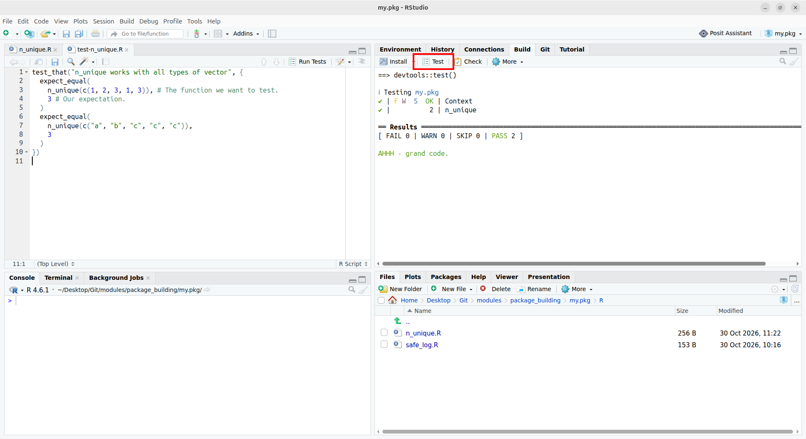
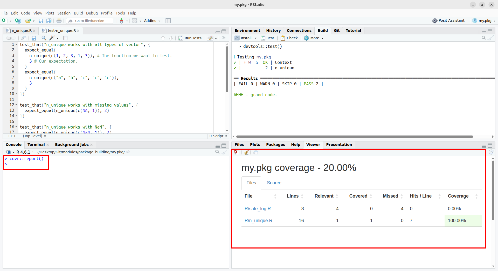

We have a working package! We have checked that it can run locally and that results are as expected, so everything seems fine.

In practice though, a package will almost always evolve in some way: we may want to add new features, such as new function arguments or entire new functions, a user may report a bug that we need to fix, maybe we will want to add more documentation at some point, among other possible changes.

As we incorporate these changes, we need to make sure that we are not breaking other functionalities of the package. We could keep running some checks manually, but this quickly becomes tedious and error-prone, or we might just forget to do it.

An essential step in package development is to **build a test suite** that can run every time we change something. Building a test suite reassures:

- the user: it shows that you (the developer) have checked that your function produces the correct results, at least in basic cases.

- yourself: it ensures you can add functionalities to your package or fix bugs without breaking your existing code.

## How to write a test suite?

### Set up the test suite

There exist several packages to create and manage a test suite. The most famous one is [`testthat`](https://testthat.r-lib.org/), but you might also be interested in [`tinytest`](https://github.com/markvanderloo/tinytest/).

To start using this package, run:

```{r}
usethis::use_testthat()
```

```r
✔ Setting active project to "/path/to/my.pkg".
✔ Adding testthat to Suggests field in DESCRIPTION.
✔ Adding "3" to Config/testthat/edition.
✔ Creating tests/testthat/.
✔ Writing tests/testthat.R.
☐ Call usethis::use_test() to initialize a basic test file and open it for editing.
```

This created a folder called `tests`:

```r
my.pkg
├── DESCRIPTION
├── NAMESPACE
├── R
├── man
├── my.pkg.Rproj
└── tests
    ├── testthat
    └── testthat.R
```

We can now add tests files in `tests/testthat`. By convention, we name test files `test-<name of the file to test>.R`, such as `test-n_unique.R`.


::: {.callout-tip}
If you have the R file you want to test opened in the editor, you can run `usethis::use_test()` to automatically create and open the corresponding test file.
:::

### Getting started with tests

When using `testthat`, a test is composed of a `test_that()` call that contains the title of the test and the code for the test, and one or several `expect_*()` calls that define your expectations, i.e. what the code should do.

Let's see how we could test `n_unique()`. This function counts unique values in a vector, so it should work with any type of vector, e.g. `numeric`, `character`, `logical`, etc. We can start by writing some cases that are easy for us to check:

```{.r filename="tests/testthat/test-n_unique.R"}
test_that("n_unique works with all types of vector", {
  expect_equal(
    n_unique(c(1, 2, 3, 1, 3)), # The function we want to test.
    3                           # Our expectation.
  )
  expect_equal(
    n_unique(c("a", "b", "c", "c", "c")),
    3
  )
})
```

We now want to check that our tests pass. There are a few ways to do that.

The simplest way is to simply evaluate the entire `test_that()` block defined above. We could also run the code inside `test_that()` line by line, but for now let's evaluate the entire block at once. Note that we need to run `devtools::load_all()` first to ensure that we use the latest version of our functions and that `testthat` is loaded in the session:

```r
test_that("n_unique works with all types of vector", {
  expect_equal(
    n_unique(c(1, 2, 3, 1, 3)), # The function we want to test.
    3 # Our expectation.
  )
  expect_equal(
    n_unique(c("a", "b", "c", "c", "c")),
    3
  )
})

Test passed with 2 successes 🥇.
```

Our tests pass! This approach is fine when we want to test one or two `test_that()` blocks, but it would quickly become annoying when we have more tests. We can use `devtools::test()` to run the entire test suite instead:

```r
> devtools::test()
ℹ Testing my.pkg
✔ | F W  S  OK | Context
✔ |          2 | n_unique                                                                                                       

══ Results ═════════════════════════════════════════════════════════════════════════════════════════════════════════════════════
[ FAIL 0 | WARN 0 | SKIP 0 | PASS 2 ]
```

In both cases, our tests depend on the global environment, which is not ideal because test results might vary across sessions. Therefore, it is recommended to run tests in a clean R session. In RStudio, you can also use the "Test" button:




### Being imaginative when writing tests

Testing the behaviour of our functions in reasonable use cases is an essential first step, and already gives us a lot of confidence when we will modify the package in the future.

However, keep in mind that users will always find ~~annoying~~ interesting bugs in your software. When writing tests, it is important to think of all the ways your functions might be misused. In practice, we will never be able to catch all these cases, but trying to address as many as possible early on already leads to massive improvements in user experience! Spending a couple of hours on this when we create the test suite can save a lot of time in the future.

Let's try to make sure our function covers corner cases!

For instance, we should make sure that missing values, `NaN`, and empty vectors are properly handled:
```{r}
test_that("n_unique works with missing values", {
  expect_equal(n_unique(c(NA, 1)), 2)
})

test_that("n_unique works with NaN", {
  expect_equal(n_unique(c(NaN, 1)), 2)

  # NA and NaN are not the same thing
  expect_equal(n_unique(c(NaN, NA)), 2)
})

test_that("n_unique works with empty vectors", {
  expect_equal(n_unique(c()), 0)
})
```

and indeed these tests also pass:

```r
> devtools::load_all()
ℹ Loading my.pkg
> devtools::test()
ℹ Testing my.pkg
✔ | F W  S  OK | Context
✔ |          6 | n_unique                                                                                                       

══ Results ═════════════════════════════════════════════════════════════════════════════════════════════════════════════════════
[ FAIL 0 | WARN 0 | SKIP 0 | PASS 6 ]
```

::: {.callout-note title="Writing tests first?"}
In this module, we defined the function before starting on tests. An alternative approach to software development is called **"test-driven development"** (TDD). It stems from the idea that writing the function first gives an incentive to only write tests that will pass, because we don't want to go back to modify the function in case we find something that goes wrong.

TDD reverses the order of development: we write tests first, laying out all our expectations about how the function *should* behave ideally, both in simple cases and in more complex cases. Only when this is done, we start writing and refining the function until it passes all of our expectations.
:::

So far, we have only used `expect_equal()`, but there are many other functions to describe our expectations:

- `expect_length()`
- `expect_type()`
- `expect_named()`
- `expect_warning()`
- and [more...](https://testthat.r-lib.org/reference/index.html)


### Testing errors

Sometimes, throwing the error is the expected behaviour. For instance, `n_unique()` should give an error because the function requires `x`, even if `x` itself is empty. One way to do this is to use `expect_error()`:

```{r}
test_that("n_unique errors if no input is provided", {
  expect_error(n_unique())
})
```

This helps, but it could be better because we don't know the error message that users will actually see. We can improve this test by providing a regular expression that the error message should match:

```{r}
test_that("n_unique errors if no input is provided", {
  expect_error(
    n_unique(),
    regexp = '"x" is missing'
  )
})
```

Still, this only ensures that our message matches this expression, but maybe some parts of the message are really not helpful to the user.

The best way to test error messages is to use a snapshot test to capture the entirety of the user-visible output.


::: {.callout-note title="A snapshot test?" collapse="true"}
Snapshot tests are tests that capture the output as the user views it. They are very useful to check side effects of function calls, such as printing messages and warnings, or when the output appearance is key, e.g. for functions that produce plots.

Snapshot tests can be run with `testthat::expect_snapshot()`. See [this vignette](https://testthat.r-lib.org/articles/snapshotting.html) on snapshot tests for more information. 
:::


```{r}
test_that("n_unique errors if no input is provided", {
  expect_snapshot(n_unique(), error = TRUE)
})
```

Note that this expectation will only be checked when run non-interactively, meaning that copying this block and running it in the R console will simply skip the test. It has to be run via `devtools::test()` or via the "Test" button in RStudio.

```
> devtools::test()
ℹ Testing my.pkg
✔ | F W  S  OK | Context
✔ |   1      7 | n_unique                                                                                                       
────────────────────────────────────────────────────────────────────────────────────────────────────────────────────────────────
Warning (test-n_unique.R:28:3): n_unique errors if no input is provided
Adding new snapshot:
Code
  n_unique()
Condition
  Error in `n_unique()`:
  ! argument "x" is missing, with no default
────────────────────────────────────────────────────────────────────────────────────────────────────────────────────────────────

══ Results ═════════════════════════════════════════════════════════════════════════════════════════════════════════════════════
[ FAIL 0 | WARN 1 | SKIP 0 | PASS 7 ]
```

On the first run, a `warning` tells us "Adding a new snapshot". From now on, this test will always compare the output of `n_unique()` (with no input) to this error message. If the message changes in the future, then this test will fail and the snapshot will either need to be updated, or the change in the message will need to be reverted.

<details>
<summary>Click to see the entire test file for `n_unique()`</summary>

```{.r filename="tests/testthat/test-n_unique.R"}
test_that("n_unique works with all types of vector", {
  expect_equal(
    n_unique(c(1, 2, 3, 1, 3)), # The function we want to test.
    3 # Our expectation.
  )
  expect_equal(
    n_unique(c("a", "b", "c", "c", "c")),
    3
  )
})

test_that("n_unique works with missing values", {
  expect_equal(n_unique(c(NA, 1)), 2)
})

test_that("n_unique works with NaN", {
  expect_equal(n_unique(c(NaN, 1)), 2)

  # NA and NaN are not the same thing
  expect_equal(n_unique(c(NaN, NA)), 2)
})

test_that("n_unique works with empty vectors", {
  expect_equal(n_unique(c()), 0)
})

test_that("n_unique errors if no input is provided", {
  expect_snapshot(n_unique(), error = TRUE)
})

```

</details>


::: {.callout-caution title="Exercise"}
Your turn! Add some tests for `safe_log()`.
:::


### Skipping tests

In some cases, you may want to skip tests, and `testthat` provides a family of functions to handle these cases. For example, you could skip tests that:

- depend on another package, using `skip_if_not_installed()`

```{r}
test_that("...", {
  skip_if_not_installed("dplyr")
  ...
})
```

- require an Internet connection (e.g if you're building a package wrapping an API), using `skip_if_offline()`

```{r}
test_that("...", {
  skip_if_offline()
  ...
})
```

- cannot work on macOS, using `skip_if_os()`

```{r}
test_that("...", {
  skip_if_os("mac")
  ...
})
```


### Do we have enough tests?

We now have some tests in our package, but do they cover all function arguments? All possible use cases?

We can use the package `covr` to see how much of our package is covered by tests:

```{r}
covr::report()
```




::: {.callout-caution}
Code coverage gives information on which parts of the code are never tested, but it doesn't mean that other parts of the code are correctly tested! 

For example, our `n_unique()` would get a 100% coverage with our very first `expect_equal()`, which is by no means enough to ensure that this function is correct.
:::


## Check a package

We have seen how to run tests, but we can now perform a more thorough check with `devtools::check()` (or the button "Check" next to "Test" in RStudio).

This is more comprehensive since it will perform a number of additional checks (on top of running the test suite), such as ensuring that you use all of your dependencies, that all examples in the documentation can run, and much more.

## Conclusion

We now have more confidence that our functions have the correct behaviour, whether it be to produce the expect results or to throw useful error messages.

The next section will present some good practices when doing package development.