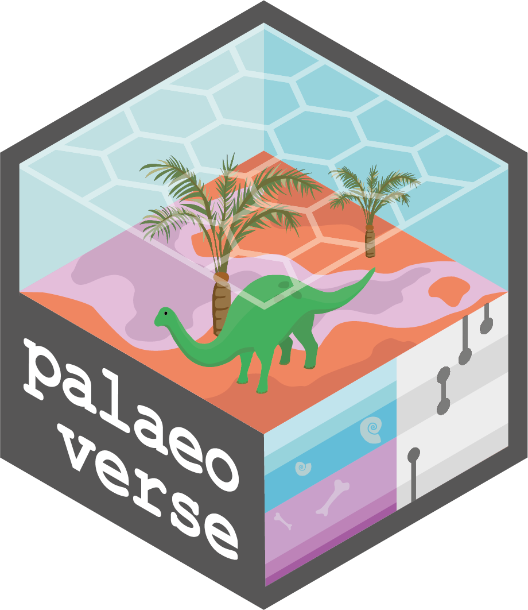

```{r}
#| label: setup
#| include: false

knitr::knit_hooks$set(par = function(before, options, envir) {
  if (before && isTRUE(options$par)) {
    # bottom, left, top, right (lines)
    par(mar = c(4, 4, 2, 1),
        # figure background
        bg = "transparent")
  }
})

knitr::opts_chunk$set(par = TRUE)
```

## Why palaeoverse?

- Analyses rarely go straight from raw data to results
- Routine but essential tasks come first: checking taxonomic names, binning occurrences, reconstructing palaeogeography
- This code is often rewritten from scratch for every project

::: {.notes}
Palaeobiological analyses rarely go straight from raw data to results. Most begin with routine but essential tasks, such as checking taxonomic names, binning occurrences in time or space, and reconstructing palaeogeographic distributions. The code to achieve such tasks is often rewritten from scratch for every project.
:::

## What does palaeoverse offer?

- **Reusable:** a few clear lines replace long, bespoke scripts
- **Reproducible:** consistent function names, arguments, and outputs
- **Readable:** well-documented, tested, and peer-reviewed functions

::: {.notes}
The **palaeoverse** R package aims to make such efforts more reusable, reproducible, and readable by:

- replacing long, bespoke scripts with a few clear lines of code
- using consistent function names, arguments, and outputs so that scripts are easy to follow and share
- providing well-documented, tested, and peer-reviewed functions that are transparent and robust
:::

# Design

Three design choices shape how **palaeoverse** functions look and behave:

- Built around occurrence data
- Modular
- Flexible

## Built around occurrence data

- Most **palaeoverse** functions take an occurrence `data.frame` as input
- Each row is a single record of something present at a particular place and time
- Each column is a different variable (e.g. identity, age, location, formation, reference)
- That "something" is usually a taxon, but not always (in the `reefs` dataset, each row is a fossil reef)

::: {.notes}
Most functions in **palaeoverse** take an occurrence `data.frame` as input, so they slot straight into the way many palaeobiologists already store their data.

What is an occurrence dataset?

In an occurrence dataset, each row is a single record of something present at a particular place and time. That "something" is usually a taxon, but it does not have to be. For example, in **palaeoverse**'s in-built `reefs` dataset, each row is a fossil reef rather than a species.

Occurrence data typically include columns describing:

- Identity, what the entity represents, such as taxonomy (e.g. accepted name, genus)
- Age (e.g. maximum and minimum ages or named intervals)
- Location (e.g. longitude and latitude)
- Additional context (e.g. formation, collection, or reference)
:::

## Occurrence `data.frame`

::: {style="font-size: 0.5em"}
```{r}
#| label: occurrence
#| echo: false
#| eval: true

library(palaeoverse)
library(knitr)
tb <- head(reefs, n = 3)
kable(tb)
```
:::

::: {.notes}
Example: built-in dataset reefs. You can see a number of different columns here such as reef number, name, formation, longitude and latitudes, and so on. However, each row represents a unique reef in space and time.
:::

## Modular

Each function in **palaeoverse** does one job well. You can use one on its own, or chain several together into a full workflow:

```{r}
#| label: modular
#| eval: true
#| output: false

# Load library and data
library(palaeoverse)
data(tetrapods)
# Get time bins
bins <- time_bins(interval = "Phanerozoic", 
                  rank = "stage")
# Bin data
bin_time(tetrapods, bins = bins, method = "mid")
# Pipe together
tetrapods |>
  bin_time(bins = time_bins(interval = "Phanerozoic", 
                            rank = "stage"), 
           method = "mid")
```

::: {.notes}
Each function in **palaeoverse** does one job well. You can use one on its own, or chain several together into a full workflow. For example, you could grab your Phanerozoic stage-level time bins and then bin, or put it all in one pipe.
:::

## Flexible

Functions in **palaeoverse** are not tied to a source (e.g. [Paleobiology Database](https://paleobiodb.org/#/)). Column names are provided as arguments, not fixed requirements:

```{r}
#| label: flexible
#| eval: true
#| output: false

# Load library
library(palaeoverse)
# Get example data
data(tetrapods)
# Get unique species
tetrapods |>
  tax_unique(genus = "genus", 
             family = "family", 
             order = "order", 
             class = "class", 
             name = "accepted_name")
```

::: {.notes}
Functions in **palaeoverse** are not tied to a single source such as the [Paleobiology Database](https://paleobiodb.org/#/). Column names are arguments rather than fixed requirements. Therefore, data from any source can be used with ease providing you have the right data available.
:::

# Applications

- Exploring and summarising data
- Cleaning and harmonising data
- Preparing data for analyses

::: {.notes}
**palaeoverse** can be used for a wide range of applications which feed into downstream analyses, including diversity dynamics, macroevolution, macroecology and biogeography.

We'll be running through two tutorials today but here are just a few possible use cases.
:::

## Exploring and summarising data

**palaeoverse** includes functions to help users explore and understand their data better, such as calculating temporal and geographic ranges:

```{r}
#| label: temporal-range
#| eval: true
#| output: false

# Load library
library(palaeoverse)
# Get example data
data(tetrapods)
# Estimate temporal range of taxa
tetrapods |>
  # Drop NAs
  subset(!is.na(order)) |>
  # Plot temporal range
  tax_range_time(name = "order", plot = TRUE)
```

::: {.notes}
**palaeoverse** includes functions to help users explore and understand their data better, such as calculating temporal and geographic ranges:
:::

## Temporal range

```{r}
#| label: temporal-range-plot
#| echo: false
#| eval: true
#| fig-cap: "Temporal range of Carboniferous to Early Triassic tetrapods."

# Load library
library(palaeoverse)
# Get example data
data(tetrapods)
tetrapods <- subset(tetrapods, !is.na(order))
dat <- tax_range_time(tetrapods, name = "order", plot = TRUE)
```

## Cleaning and harmonising data

**palaeoverse** includes functions to support the cleaning and harmonising of data such as removing duplicates and checking taxonomic names:

```{r}
#| label: check-names
#| eval: true
#| output: false

# Load library
library(palaeoverse)
# Get example data
data(tetrapods)
# Check for potential misspellings
tax_check(tetrapods, name = "genus")
```

::: {.notes}
**palaeoverse** includes functions to support the cleaning and harmonising of data such as removing duplicates and checking taxonomic names:
:::

## Preparing data for analyses

**palaeoverse** includes functions to prepare data for analyses, such as estimating palaeocoordinates and binning data:

```{r}
#| label: bin-lat
#| eval: true

# Load library and data
library(palaeoverse)
data(reefs)
# Generate equal-area latitudinal bins
bins <- lat_bins_area(n = 12)
head(bins, n = 3)
# Bin data
binned_reefs <- bin_lat(reefs, bins = bins)
```

::: {.notes}
**palaeoverse** includes functions to prepare data for analyses, such as estimating palaeocoordinates and binning data:
:::

## So, what is **palaeoverse**?

{fig-align="center"}

> *Think of **palaeoverse** as the bridge between raw occurrence data and the analytical methods you want to apply.*

::: {.notes}
Think of **palaeoverse** as the bridge between raw occurrence data and the analytical methods you want to apply.
:::

# Getting help

- Everyone gets stuck with new tools, and knowing where to look for help is a key skill
- **palaeoverse** has several layers of support, from built-in documentation to community help

::: {.notes}
Everyone gets stuck with using new tools from time-to-time, and knowing where to look for help is one of the most useful skills to develop. As with most R packages, **palaeoverse** has several layers of support, from built-in documentation to wider community support.
:::

## [palaeoverse.palaeoverse.org](https://palaeoverse.palaeoverse.org)

hosts:

- documentation for every function
- vignettes (tutorials) showing example applications
- updates on new releases
- Searchable, and often easier to navigate than R help pages

::: {.notes}
The **palaeoverse** website ([https://palaeoverse.palaeoverse.org](https://palaeoverse.palaeoverse.org)) hosts documentation for every function available, as well as vignettes (tutorials) demonstrating possible applications, and updates on new releases. It is a searchable resource and can be easier to navigate than the help pages in R.
:::

##

](img/palaeoverse-reference.png){fig-align="center"}

## Still stuck?

- **GitHub:** search existing [issues](https://github.com/palaeoverse/palaeoverse/issues) to see if your problem has been addressed
- Can't find an answer? [Open an issue](https://github.com/palaeoverse/palaeoverse/issues) with a minimal reproducible example (see [reprex guidance](https://reprex.tidyverse.org/articles/reprex-dos-and-donts.html))
- **Zulip:** new to GitHub? [Join our Zulip](https://palaeoverse.org/zulip/join-zulip/) and create a topic under "Help"

::: {.notes}
If you are familiar with GitHub, you can search existing issues in the **palaeoverse** repository to see whether someone has previously encountered the issue you are facing and whether it has already been addressed. If you cannot find an answer, you are welcome to open an issue and include a minimal reproducible example.

GitHub can be a daunting place if you have not used it before. You are welcome to join our [Zulip](https://palaeoverse.org/zulip/join-zulip/) and create a topic under "Help".
:::

##

 **palaeoverse**'s Zulip and ask for help if you are still stuck after reading the package documentation.](img/zulip.png)

# Now, let's get coding!

...starting with installing **palaeoverse**:

```{r}
#| label: install-packages
#| eval: false

install.packages("palaeoverse")
```

- [**Tutorial 1: Tetrapod biodiversity**](tetrapod-biodiversity.qmd): Explore alpha diversity and geographic range size in Carboniferous and Permian tetrapods.
- [**Tutorial 2: Phanerozoic reefs**](phanerozoic-reefs.qmd): Investigate latitudinal trends in Phanerozoic reefs.
