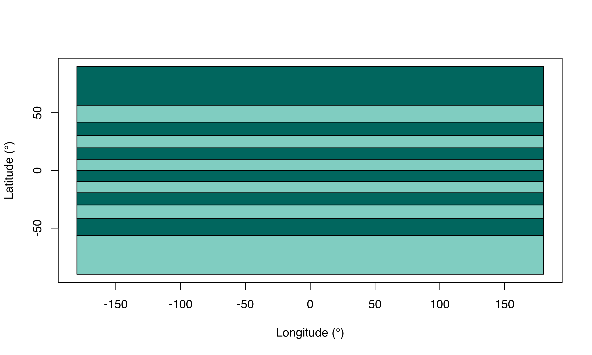
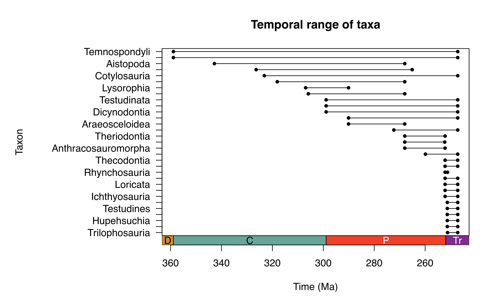

<!-- ENSURE THAT THIS DOCUMENT FOLLOWS THE MODULE STRUCTURE DESCRIBED IN THE GUIDELINES -->
<!-- https://docs.google.com/document/d/16cxSA2bA1MnrnpzmN2yzJNCwJVO7Hm5ceyz10sCmnzY/edit?tab=t.0 -->

# Why use palaeoverse

Palaeobiological analyses rarely go straight from raw data to results. Most begin with routine but essential tasks, such as checking taxonomic names, binning occurrences in time or space, and reconstructing palaeogeographic distributions, which are often rewritten from scratch for every project.

The **palaeoverse** R package aims to make such efforts more reusable, reproducible, and readable by:

- Replacing long, bespoke scripts with a few clear lines of code
- Using consistent function names, arguments and outputs so that scripts are easy to follow and share
- Providing well-documented, tested and peer-reviewed functions that are transparent and robust

# Design

Three design choices shape how **palaeoverse** functions look and behave.

## Built around occurrence data

Most functions in **palaeoverse** take an occurrence `data.frame` as input, so they slot straight into the way many palaeobiologists already store their data.

::: {.callout-note}
## What is an occurrence dataset?

In an occurrence dataset, each row is a single record of something present at a particular place and time. That "something" is usually a taxon, but it does not have to be. For example, in the in-built `reefs` dataset, each row is a fossil reef rather than a species.

Occurrence data typically include columns describing:

- *Taxonomy* (e.g. accepted name, genus, and family)
- *Age* (e.g. maximum and minimum ages or named intervals)
- *Location* (e.g. longitude and latitude)
- *Additional context* (formation, collection, or reference)

It could look something a little like this:

  | occurrence_no   | accepted_name   | max_ma   | min_ma   | lng      | lat     | …     |
  | --------------: | --------------: | -------: | -------: | -------: | ------: | ----: |
  |           40163 |      Crocodylia |     59.2 |       56 |   −74.68 |   39.97 |     … |
  |           40167 |     Gavialoidea |     59.2 |       56 |   −74.68 |   39.97 |     … |
  |           40168 |     Gavialoidea |     59.2 |       56 |   −74.68 |   39.97 |     … |
  |               … |               … |        … |        … |        … |       … |     … |
:::

## Modular

Each function in **palaeoverse** does one job well. Use one on its own, or chain several together into a full workflow.

```{r}
#| label: modular
#| eval: false

# Load library
library(palaeoverse)
# Get example data
data(tetrapods)
# Get time bins
bins <- time_bins(interval = "Phanerozoic", rank = "stage")
# Bin data temporally
tetrapods |>
  bin_time(bins = bins, method = "mid")
```

## Flexible

Functions in **palaeoverse** are not tied to a single source such as the [Paleobiology Database](https://paleobiodb.org/#/). Column names are generally arguments rather than fixed requirements, so data from any source can be used with ease.

```{r}
#| label: flexible
#| eval: false

# Load library
library(palaeoverse)
# Get example data
data(tetrapods)
# Get time bins
bins <- time_bins(interval = "Phanerozoic", rank = "stage")
# Bin data temporally
tetrapods |>
  bin_time(bins = bins, method = "mid")
```

# Applications

**palaeoverse** can be used for a wide range of applications which feed into downstream analyses, including diversity dynamics, macroevolution, macroecology and biogeography. A preview of this is provided below, but the module exercises ([Exercise 1: Tetrapod biodiversity](tetrapod-biodiversity.qmd), [Exercise 2: Phanerozoic reefs](phanerozoic-reefs.qmd)) will expose you to the full functionality and use cases of **palaeoverse** functions.

## Cleaning and standardising data

Whether you are removing duplicates, standardising ages, checking taxonomic names for potential misspellings, **palaeoverse** can help support such tasks:

```{r}
#| label: check-names
#| eval: false

# Load library
library(palaeoverse)
# Get example data
data(tetrapods)
# Check for potential misspellings
tax_check(tetrapods, name = "genus")
```

## Binning data

Most diversity and biogeographic analyses require temporal and spatial units. The **palaeoverse** package provides functions to generate temporal and spatial bins, and bin data into those bins:

```{r}
#| label: bin-lat
#| eval: false

# Load library
library(palaeoverse)
# Get example data
data(reefs)
# Generate equal-area latitudinal bins
bins <- lat_bins_area(n = 12, plot = TRUE)
# Bin data
bin_lat(reefs, bins)
```



## Palaeogeographic reconstruction

Research on the deep-time spatial distribution of biodiversity requires estimating where organisms were located at the time of deposition. The **palaeoverse** package can support such research:

```{r}
#| label: palaeorotate
#| eval: false

# Load library
library(palaeoverse)
# Get example data
data(tetrapods)
# Add midpoint age
tetrapods$mid_ma <- (tetrapods$max_ma + tetrapods$min_ma) / 2
# Bin data into equal-area hexagonal cells
palaeorotate(tetrapods, age = "mid_ma", model = "PALEOMAP")
```

## Summarising data

Several functions are included in **palaeoverse** to help users explore and understand their data better, such as estimating temporal and geographic ranges:

```{r}
#| label: temporal-range
#| eval: false

# Load library
library(palaeoverse)
# Get example data
data(tetrapods)
# Estimate temporal range of taxa
tetrapods |>
  # Drop NAs
  subset(!is.na(order)) |>
  # Plot temporal range
  tax_range_time(name = "order", plot = TRUE)
```



::: {.callout-note}
## Where does palaeoverse fit?

Think of palaeoverse as the bridge between raw occurrence data and the analytical methods you want to apply.
:::

# Getting help

Everyone gets stuck with using new (and familiar) tools from time-to-time, and knowing where to look is one of the most useful skills you can develop. As with most packages, *palaeoverse* has several layers of support, from built-in documentation to wider community support.

The *palaeoverse* [website](https://palaeoverse.palaeoverse.org) hosts the full function documentation, vignettes and updates on new releases. It is searchable and can be easier to browse than the help pages in R.

.](img/palaeoverse-reference.png)

If you are familiar with GitHub, you can also check existing issues within the dedicated [repository](https://github.com/palaeoverse/palaeoverse/), as someone may already have asked your question. If you cannot find an answer to your question, you can open an [issue](https://github.com/palaeoverse/palaeoverse/issues) on GitHub (see [best practises](https://reprex.tidyverse.org/articles/reprex-dos-and-donts.html)).

::: {.callout-tip}
GitHub can be a *scary* place if you are not familiar with it. So, you can also reach out by [email](mailto:info@palaeoverse.org) if you are facing difficulties or join our [Zulip](https://palaeoverse.org/zulip/join-zulip/), and raise a topic.
:::
