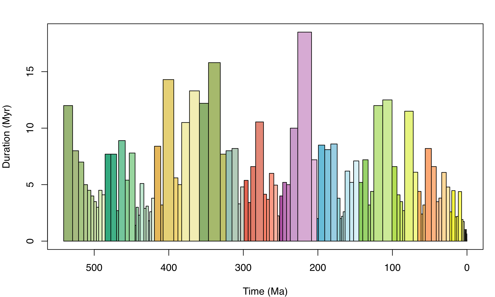

<!-- ENSURE THAT THIS DOCUMENT FOLLOWS THE MODULE STRUCTURE DESCRIBED IN THE GUIDELINES -->
<!-- https://docs.google.com/document/d/16cxSA2bA1MnrnpzmN2yzJNCwJVO7Hm5ceyz10sCmnzY/edit?tab=t.0 -->

## Preamble

In this tutorial, you will use **palaeoverse** to explore latitudinal trends in Phanerozoic reefs.

Along the way, you will meet the functions you need for a typical palaeobiological workflow: exploring data, assigning a common time scale, binning occurrences, estimating palaeocoordinates, and summarising the results.

::: {.callout-note}
## How exercises work

- **Questions:** work out your answer in R first, then click the "Answers" box beneath the questions to check it.
- **Hints and solutions:** click the boxes labelled "Hint" or "Solution" to reveal them, but make sure to try the task yourself first!
- **Your turn:** code chunks marked `___` are incomplete. Replace each `___` before running them locally.
:::

## Introduction

Reefs, especially tropical coral reefs, are commonly thought to be highly sensitive to climate change (Kiessling, 2001; Perrin & Kiessling, 2010), and their distribution has been used to infer the latitudinal extent of tropical and subtropical climatic conditions in deep time.

As palaeobiologists we know that we cannot take the present-day distribution of fossil reef systems at face value--we must contend with the shift of the continents over geological timescales. Specifically, the geographic location of fossil occurrences on the Earth's surface today does not necessarily represent their location *in vivo*; fossil remains found at tropical latitudes might have been deposited at temperate latitudes and vice versa.

As such, to be able to trace the latitudinal distribution of reefs in the geological past, we must reconstruct their past geographic distribution using a Global Plate Model. However, recent work has also demonstrated that there can be substantial differences between Global Plate Models in their palaeogeographic reconstructions, so we must also consider this uncertainty ([Buffan et al., 2023](https://doi.org/10.1111/2041-210X.14204)).

Let's start by loading **palaeoverse**:

```{r}
#| label: load-palaeoverse
#| eval: true

# Install palaeoverse (if required)
# install.packages("palaeoverse")
# Load palaeoverse
library(palaeoverse)
```

## The `reefs` dataset

In this tutorial, we will be using `reefs` for our analyses, a compilation of Phanerozoic reef occurrences (*n* = `r nrow(palaeoverse::reefs)`) from the [PaleoReefs Database](https://www.paleo-reefs.pal.uni-erlangen.de) (Kiessling & Krause, 2022).

::: {.callout-note}
## Built-in datasets

Recall from the [introduction](introduction.qmd) that functions in **palaeoverse** are designed around the assumption that your data are stored in an occurrence `data.frame`, which is the expected input for almost all functions. The package includes two example occurrence datasets from different data sources: `tetrapods` and `reefs`.
:::

Load the `reefs` dataset:

```{r}
#| label: load-reefs
#| eval: true

# Load in-built dataset
data(reefs)
```

Before conducting any analyses, it is always a good idea to explore your data and understand what you are working with:

```{r}
#| label: structure-reefs

# View the first six rows
head(reefs)
# Look at the structure of the dataset
str(reefs)
```

Note the structure of the dataset: each row contains a unique occurrence and each column contains a unique variable. Details on the dataset (e.g. origin) are also available via the usual documentation call:

```{r}
#| label: reefs-help

# Call documentation for dataset
?reefs
# You can also use
help(reefs)
```

::: {.callout-caution}
## Exercise 1: Get to know `reefs`

Use `nrow()`, `ncol()`, and `?reefs` to answer the following.

1. How many rows does `reefs` have?
2. How many columns does `reefs` have?
3. What does each row of `reefs` represent?
4. True or false: the `reefs` dataset tells us how many species lived in each reef.
:::

::: {.callout-tip collapse="true" title="Answers"}
1. `r nrow(reefs)`
2. `r ncol(reefs)`
3. A whole reef (an ecosystem).
4. False. Each row describes a reef as a whole, not all the species within it.
:::

Not bad, that is quite a bit of data to play with! Remember that these are reefs (whole ecosystems), not individual occurrences of fossil organisms like in the `tetrapods` dataset. **But how does the number of occurrences vary across time?** We can make use of the `group_apply()` wrapper function to run a function across subsets of data.

```{r}
#| label: group-apply-interval

# Group by the interval column to calculate nrow x interval
reef_counts <- group_apply(reefs, group = "interval", fun = nrow)
head(reef_counts)
```

::: {.callout-caution}
## Exercise 2: Spot the problem

1. How many different interval names are there in `reefs`?
2. Why is this a problem for counting reefs through time?
:::

::: {.callout-tip collapse="true"}
## Hint

`group_apply()` returns one row per group. How many groups did you get?
:::

::: {.callout-tip collapse="true"}
## Answers

1. `r nrow(reef_counts)`
2. Intervals differ in resolution and naming scheme, so counts are not comparable.
:::

Oh dear, we have just hit a common issue: our reef data do not conform to a common time scale. Some reefs are resolved to stage level, while others are resolved to a coarser or finer temporal resolution. In some instances, regional names are used, while international names are used in others. This makes comparisons through time challenging.

## Assign common time scale

One solution would be to use age values to bin the reefs into time bins, but no numeric age range data are provided in the `reefs` dataset (i.e. `max_age` and `min_age`). We must therefore use the name of each interval to link to a common time scale: the [international geological stages](https://stratigraphy.org/chart) established by the International Commission on Stratigraphy (ICS).

Fortunately, we can make use of the `look_up()` function help us do this. It can assign international geological stages and numeric ages to occurrences, or use a user-defined interval key to link to a common time scale. Here, we can do the latter using the example `interval_key` available in **palaeoverse**.

Load `interval_key`:

```{r}
#| label: interval-key
#| output: false

# Load the interval key
data("interval_key")
# View first six rows
head(interval_key)
```

::: {.callout-caution}
## Exercise 3: Get to know `interval_key`

1. What columns does `interval_key` contain?
2. What is the source of `interval_key`?
:::

::: {.callout-tip collapse="true"}
## Answers

1. Use `colnames(interval_key)`: `r colnames(interval_key)`
2. Use `help(interval_key)` or `?interval_key`: geowhen
:::

Using `interval_key`, we can now assign international geological stages and numeric ages to our `reefs` dataset, using `look_up`:

```{r}
#| label: look-up

# Assign a common time scale based on an interval key
reefs <- look_up(reefs,
                 early_interval = "interval",
                 late_interval = "interval",
                 int_key = interval_key)
# View first six rows
head(reefs)[, c("interval", "interval_max_ma", "interval_min_ma")]
```

Great! We now have a common time scale and numeric ages. However, some of our reefs seem to range through several stages (e.g. "lower Norian"), so we cannot simply count by the early or late stage. Our data still need to be binned.

Let's check out the `time_bins()` and `bin_time()` functions:

```{r}
#| label: time-bins

# Extract Phanerozoic stage-level time bins
bins <- time_bins(interval = "Phanerozoic", rank = "stage")
head(bins)
```



```{r}
#| label: subset-reefs

# Now we have numeric ages for our data, we can easily
# remove pre-Phanerozoic data to focus our study
reefs <- subset(reefs, interval_max_ma <= max(bins$max_ma))
# bin_time() defaults to "max_ma" and "min_ma" columns
# Rename columns in reefs
colnames(reefs)[which(colnames(reefs) == "interval_max_ma")] <- "max_ma"
colnames(reefs)[which(colnames(reefs) == "interval_min_ma")] <- "min_ma"
```

Five methods exist in `bin_time()` for binning occurrence data. You can see details on each via `?bin_time`:

```{r}
#| label: time-bin-methods
#| eval: false

# Bin by midpoint age
bin_time(reefs, bins = bins, method = "mid")
# Bin by overlap majority
bin_time(reefs, bins = bins, method = "majority")
# Bin into every bin within age range
bin_time(reefs, bins = bins, method = "all")
# Bin randomly into bins within age range (equal probability)
bin_time(reefs, bins = bins, method = "random", reps = 10)
# Bin randomly into bins within age range (uniform probability)
bin_time(reefs, bins = bins, method = "point", reps = 10)
```

::: {.callout-caution}
## Exercise 4: Choose a temporal binning method

Before we pick a method, let's see how the choice affects the data.

```{r}
#| label: exercise-4-time-bins
#| eval: false

# Your turn: bin the reefs using the "majority" method
reefs_majority <- bin_time(reefs, max_ma = ___, min_ma = ___, bins = ___, method = ___)
# How many rows does the result have?
nrow(___)
```

```{r}
#| label: exercise-4-time-bins-hidden
#| include: false

n_reefs_before <- nrow(reefs)
binned_reefs <- bin_time(reefs, bins = bins, method = "majority")
n_reefs_majority <- nrow(binned_reefs)
n_reefs_filtered <- nrow(binned_reefs[which(binned_reefs$overlap_percentage > 50), ])
```

1. How many rows does `reefs` have after binning with `method = "majority"`?
2. How many rows does `reefs` have if we filter "overlap_percentage" to more than 50%?
3. Which method would you expect to *increase* the number of rows?
:::

::: {.callout-tip collapse="true"}
## Answers

1. Trick question! It's the same: `r n_reefs_majority`
2. `r n_reefs_filtered`
3. `"all"`
:::

We will go with `"all"` for this tutorial:

```{r}
#| label: bin-all

reefs <- bin_time(reefs, bins = bins, method = "all")
```

Note that the number of rows of `reefs` has now increased: the `"all"` method duplicates an occurrence for every bin its age range overlaps with.

::: {.callout-info collapse="true"}
## How many rows did we gain?

`reefs` grew from `r n_reefs_before` to `r nrow(reefs)` rows. Each extra row is a copy of a reef placed in an additional bin.
:::

Let's check those reef numbers through time again using our binned data:

```{r}
#| label: reefs-time

# Count number of reefs per time bin
reefs_time <- group_apply(reefs, group = "bin_midpoint", fun = nrow)
# Make sure bins are in chronological order
reefs_time <- reefs_time[order(as.numeric(reefs_time$bin_midpoint)), ]
# Check output
head(reefs_time)
```

That is more like it! But let's not forget it is always useful to visualise our data. Why don't we plot the number of reefs through time? We can make use of the `axis_geo()` function to add the geological time scale to our plot:

```{r}
#| label: n-reefs
#| fig-cap: "Counts of the number of reefs per international geological stage."

# Plot data
plot(x = reefs_time$bin_midpoint,
     y = reefs_time$nrow,
     xlab = "Time (Ma)",
     ylab = "Number of reefs per stage",
     xlim = c(541, 0),
     xaxt = "n",
     type = "b", pch = 20)
# Add axis of the geological time scale
axis_geo(side = 1, intervals = "periods")
```

## References

Buffan, L., Jones, L. A., Domeier, M., Scotese, C. R., Zahirovic, S., & Varela, S. (2023). Mind the uncertainty: Global plate model choice impacts deep‐time palaeobiological studies. Methods in Ecology and Evolution, 14(12), 3007-3019. DOI: [10.1111/2041-210X.14204](https://doi.org/10.1111/2041-210X.14204)

Kiessling, W. (2001). Paleoclimatic significance of Phanerozoic reefs. *Geology*, 29, 751--754. DOI: [10.1130/0091-7613(2001)029%3C0751:PSOPR%3E2.0.CO;2](https://doi.org/10.1130/0091-7613(2001)029%3C0751:PSOPR%3E2.0.CO;2)

Kiessling, W. & Krause, M. C. (2022). PaleoReefs Database (PARED) (1.0) [Data set]. DOI: [10.5281/zenodo.6037852](https://doi.org/10.5281/zenodo.6037852).

Merdith, A., Williams, S. E., Collins, A. S., Tetley, M. G., Mulder, J. A., Blades, M. L., Young, A., Armistead, S. E., Cannon, J., Zahirovic, S., & Müller, R. D. (2021). Extending full-plate tectonic models into deep time: Linking the Neoproterozoic and the Phanerozoic. *Earth-Science Reviews*, 214, 103477. DOI: [10.1016/j.earscirev.2020.103477](https://doi.org/10.1016/j.earscirev.2020.103477).

Perrin, C. & Kiessling, W. (2010). Latitudinal trends in Cenozoic reef patterns and their relationship to climate. *Carbonate Systems during the Oligocene--Miocene Climatic Transition*, 17--33. DOI: [10.1002/9781118398364.ch2](https://doi.org/10.1002/9781118398364.ch2)

Scotese, C. & Wright, N. M. (2018). PALEOMAP Paleodigital Elevation Models (PaleoDEMs) for the Phanerozoic. [PALEOMAP Project](https://www.earthbyte.org/paleodem-resource-scotese-and-wright-2018/).

Wright, N., Zahirovic, S., Müller, R. D., & Seton, M. (2013). Towards community-driven paleogeographic reconstructions: integrating open-access paleogeographic and paleobiology data with plate tectonics. *Biogeosciences*, 10(3), 1529--1541. DOI: [10.5194/bg-10-1529-2013](https://doi.org/10.5194/bg-10-1529-2013).
